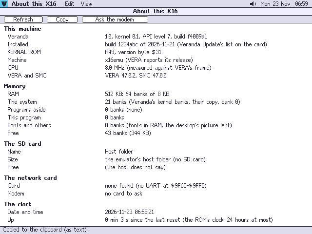

# About this X16

About this X16 shows what your machine is and how it is doing, in one
window. Use it for a quick look, or to copy the facts into a bug report.

## Start it

Double-click **About this X16** in `/VERANDA/APPS`.

## What it shows

- **This machine**: Veranda's version and build (and the build installed
  by [Veranda Update](Veranda-Update.md)); the KERNAL ROM's release (R49
  ...); the machine (the Commander X16, or the emulator); the CPU's speed,
  measured; VERA's version and the SMC's firmware.
- **Memory**: the RAM (512 KB is 64 banks of 8 KB); the system's part;
  the programs put aside with Alt+Tab, each with its banks; this
  program's; the rest in use; the free banks.
- **The SD card**: its name, the size, the free space.
- **The network card**: the serial port where TexElec's card is (`$9FE0`
  from the factory), or none. Nothing is sent to the modem until you
  click **Ask the modem**. Then it sends `AT` and `ATI` only and shows
  the firmware's line (Zimodem's version). **Esc** stops it.
- **The clock**: the date and time, and the time since the last reset.

The clock, the memory and the time since reset are updated every
second.

## Buttons and keys

| Button | Key | Action |
|---|---|---|
| Refresh | R | read everything again |
| Copy | C (or Edit > Copy all) | put all the facts on the clipboard as text, to paste into a bug report (in Veranda Edit, Note Pad ...) |
| Ask the modem | | ask the modem its version |

**Ctrl+Q** quits. The menus show each item's key at the right.
**Alt+Tab** puts it aside at any time.

## A hardware check

What a stock X16 should show:

- KERNAL ROM R49 (or your release); Machine "Commander X16"; CPU about
  8.0 MHz; VERA 0.3.x; the SMC's version (or "the SMC does not say").
- RAM 512 KB: 64 banks, 44 for programs with nothing aside.
- Put a program aside with Alt+Tab and open About again: it is listed
  with its banks.
