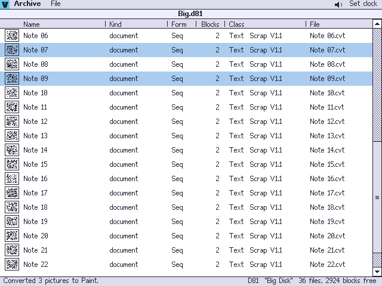

# Archive

Archive opens **C64 and C128 GEOS disk images** (`.D64`, `.D71`,
`.D81`) on the SD card. It lists their files and copies them out to
the card, so you can use old GEOS documents on Veranda.

## Start it

- Double-click a `.D64`, `.D71` or `.D81` file.
- Or double-click **Archive** in `/VERANDA/APPS` and choose **File >
  Open...**.

## What it does

- Lists the disk's files in a window titled with the image's name: each
  file's icon, name, kind, form (VLIR or sequential), size in blocks,
  class and the name it gets on the card. Plain CBM files are listed too.
  The status bar shows the disk's name, its number of files and its free
  blocks.
- **Extract**: copies the selected files into the folder where the disk
  image is.
  - A GEOS file becomes a `.cvt` file (its GEOS name kept inside).
  - A plain PRG, SEQ or USR file is copied as it is.
- **To Paint**: turns geoPaint documents, Photo Scraps and photo albums
  into [Paint](Paint.md) pictures.

Click a file to select it (click again to unselect); selected files are
highlighted. **File > Select all** selects every file. The scroll bar at
the right moves the list: its arrows a file at a time, its track a page.

## Menus and keys

| Menu | Items |
|---|---|
| Archive | About Archive, Quit (Ctrl+Q) |
| File | Open... (Ctrl+O), Select all (Ctrl+A), Extract (Ctrl+E), To Paint |

| Key | Action |
|---|---|
| Up, Down | the list a file up or down |
| PgUp, PgDn | the list's previous or next page |
| Ctrl+O, Ctrl+A, Ctrl+E, Ctrl+Q | Open..., Select all, Extract, Quit |

## Notes

- Archive only reads disk images. It never writes to them.
- Veranda does not run C64 GEOS **programs**. Extracted documents can be
  opened by Veranda programs that know them (Paint pictures, text).
- On a PC, `tools/vdisk.py` in the source does the same.
