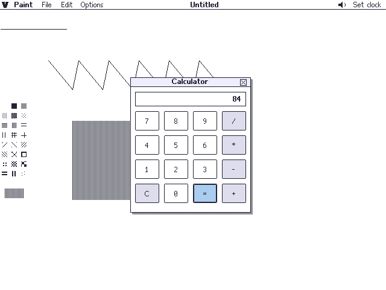

# Calculator

A pocket calculator in a window. It is a
[desk accessory](Desk-accessories.md): it opens over any program.

## Use it

Click the keys, or type them:

| Key | Action |
|---|---|
| 0 to 9 | digits |
| + - * / | add, subtract, multiply, divide |
| = or Return | the result |
| C | clear |
| Esc | close the Calculator |

The close box at the right of the title bar also closes it.

## How it counts

- Whole numbers only (32 bits: up to about two thousand million, and
  negative numbers).
- Like a pocket calculator, an operator works on the result so far:
  `2 + 3 * 4 =` gives 20, not 14.
