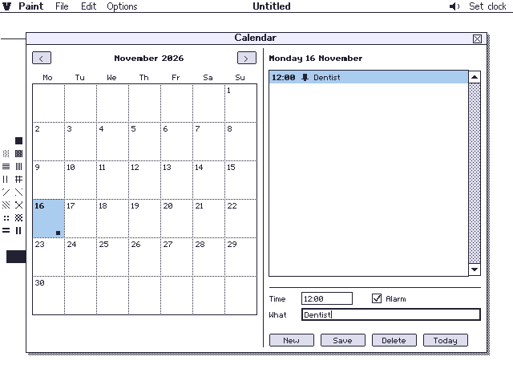
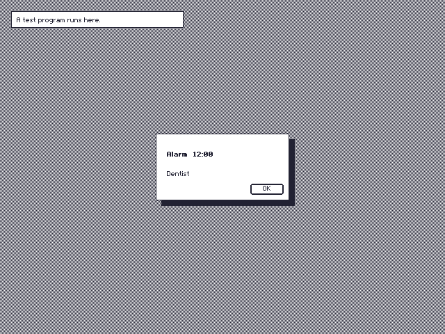

# Calendar

The Calendar shows a month and the appointments of a day, and rings
**alarms**. It is a [desk accessory](Desk-accessories.md): it opens over
any program.

## The window

- **The month**: a grid, Monday first. Today is yellow (from the X16's
  clock). The chosen day is light blue. Days with appointments have a
  mark. **<** and **>** change the month; **Today** goes back to today.
- **The day**: its appointments in time order, and a form to add or
  change one: the **time**, the **text**, and the **Alarm** check box.
  The scroll bar beside the list moves it when a day has more
  appointments than it shows.

## Appointments

- **New** fills the form: the next minute if the day is today, else
  09:00.
- Type the time and the text, tick **Alarm** if you want one, and
  click **Save** (or press Return).
- Click an appointment to change it, then **Save**.
- **Delete** removes the chosen appointment (after a question).

| Key | Action |
|---|---|
| Tab | between the time and the text |
| Return | save |
| Arrows | move the chosen day |
| PgUp, PgDn | the previous, the next month |
| Esc | close the Calendar |

## Alarms

An alarm rings **over any program** while Veranda runs: a sound and a
box with the appointment's text. Click OK to close the box.

- The alarms work only while Veranda runs. An alarm whose time passes
  while the X16 is off or in BASIC does not ring later.
- Set the clock first: see [Date, time and time zone](Date-and-time.md).

## Where the appointments are

In the file **Appointments** in `/VERANDA/.SYSTEM`: up to 120
appointments, in the years 2000 to 2099. Veranda keeps the next 8
alarms ready. The coming alarms are also written to **Veranda Alarms** there,
which Veranda reads when it starts.
