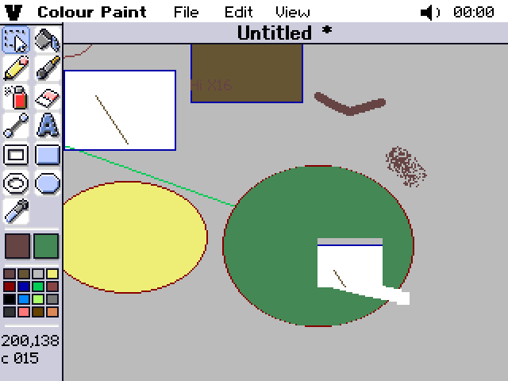
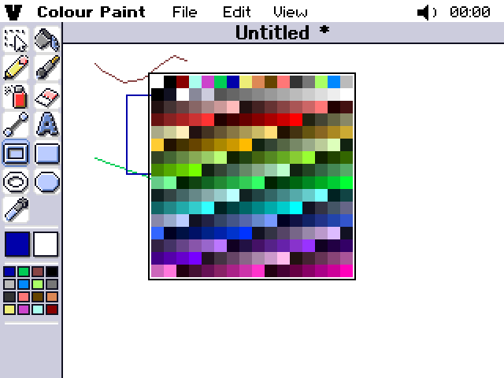
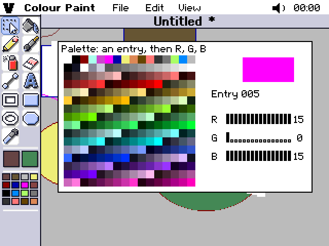

# Colour Paint

Colour Paint is a drawing program in colour. A picture is 320 x 240
pixels, and each pixel can be any of 256 colours. While Colour Paint
runs, the screen is in the 320 x 240 mode, so the menus and boxes look
larger than usual.

Colour Paint comes with [Paint](Paint.md); both are in `/VERANDA/APPS`.
Use Paint for large black and white pictures with patterns, and Colour
Paint for small pictures in colour.

## Start it

- Double-click **Colour Paint** in `/VERANDA/APPS`.
- Double-click a Colour Paint picture: Colour Paint opens it.

Colour Paint needs 21 free RAM banks. Close other programs first if it
says there are not enough.

## The screen

- **The menu bar**: Colour Paint, File, Edit and View.
- **The picture's name** in the band above the picture. A `*` after it
  means there are changes that are not saved.
- **The column** on the left:
  - **the tools**, two a row: **selection**, **fill**, **pencil**,
    **brush**, **spray**, **eraser**, **line**, **text**, **rectangle**,
    **filled rectangle**, **oval**, **filled oval** and the
    **eyedropper**. The chosen tool sits on a blue plate.
  - **the two colour wells**: **colour A** (left) draws, and
    **colour B** (right) fills the inside of a filled rectangle or a
    filled oval.
  - **the recent colours**: the last 16 colours you chose for colour A.
    Click one to make it colour A again.
  - **the status**: where the pointer is in the picture (in pixels from
    its top left), and the number of the colour under it (0-255).
- **The picture**: the rest of the screen shows 280 x 212 pixels of it.
  The arrow keys scroll it by 8 pixels.

## Choosing colours

Click a colour well: a box with all 256 colours opens, 16 x 16. Click a
colour to put it in that well. A click outside the box closes it.

The **eyedropper** tool takes the colour of the pixel you click as
colour A.

## The tools

- **Selection**: drag out an area. Then use Cut, Copy or Paste in the
  Edit menu.
- **Fill**: click in an area. The area of that colour around the click
  gets colour A. A large area can take a second or two.
- **Pencil**: draw thin lines as you drag.
- **Brush**: paint with a round tip, 5 pixels across, as you drag.
- **Spray**: hold the button down to spray dots around the pointer.
- **Eraser**: rub out 8 x 8 pixels at a time, to colour 0 (the paper).
- **Line**: drag from one end to the other.
- **Text**: click where the text goes and type a line (up to 40
  characters), then press Return. The text is in colour A.
- **Rectangle** and **oval**: drag a frame in colour A.
- **Filled rectangle** and **filled oval**: drag a shape: the edge in
  colour A, the inside in colour B.
- **Eyedropper**: click a pixel to make its colour colour A.

## The palette

**View > Palette...** opens the palette editor. Click one of the 256
colours, then click the bars to set its red, green and blue (16 steps
each). The picture changes at once. Colours 0, 1 and 17-20 are used by
the menus and the mouse pointer, so they cannot be changed. A click
outside the box closes it.

The palette is saved with the picture.

## Menus

| Menu | Items |
|---|---|
| Colour Paint | About Colour Paint, Desk accessory... |
| File | New (Ctrl N), Open... (Ctrl O), Save (Ctrl S), Save as..., Export for Paint..., Export as BMP..., Print... (Ctrl P), Quit (Ctrl Q) |
| Edit | Undo (Ctrl Z), Cut (Ctrl X), Copy (Ctrl C), Paste (Ctrl V) |
| View | Whole picture (Ctrl W), Palette... |

- **Edit > Undo** takes back the last change. Undo again puts it back.
- **Cut** and **Copy** keep the selected area, with its colours. Cut
  leaves colour 0 behind. **Paste** shows the area floating under the
  pointer; click to put it down.
- Copy also puts a black and white copy on Veranda's clipboard, for
  other programs. When another program has put a picture on the
  clipboard since, Paste pastes that one, in colour 1 (black).
- **View > Whole picture** shows all of the picture, without the menus
  and the column, until you click or press a key.

## Files

- **Save** and **Save as** write a Colour Paint picture (a GEOS
  document, `Name.cvt` on the card). The first Save goes to
  `/DOCUMENTS`. Long names are fine.
- **Open** opens Colour Paint pictures and also [Paint](Paint.md)
  pictures. A Paint picture opens at half size, in black and white.
- **Export for Paint...** writes a black and white Paint picture of the
  top left 296 x 232 pixels. Each pixel becomes 2 x 2 dots, more of
  them black the darker its colour is. The name gets ` BW` at the end
  unless you change it.
- **Export as BMP...** writes the picture as a BMP file (8 bits a pixel,
  with its 256 colours) for a PC. `.bmp` is added if the name has no
  dot.
- **Print...** writes the picture to a **PDF** file, A4, in black and
  white dots as in Export for Paint. `.pdf` is added if the name has no
  dot. Print the PDF on a PC. Printing takes about 20 seconds.

## Limits

- One size of picture: 320 x 240.
- One step of undo.
- The text tool has one font, the system font.
- [View](View.md) does not show Colour Paint pictures. Export them as
  BMP files to view them.
