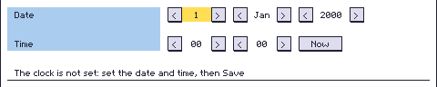

# Date, time and time zone

The X16 has a battery-backed clock. Veranda shows its date and time at
the right of the menu bar. When you set the clock in Veranda, it is
written to the X16's clock, so it stays set after you turn the machine
off.

## Is the clock set?

A clock that was never set reads 1 January 2000. Then the menu bar
says **Set clock** instead of the time. Some programs need a correct
clock: [Veranda Ask](Veranda-Ask.md) uses it to know when its sign-in
must be renewed, and the chats and calendar use it for dates.

## Set the date and time

1. Click the date and time (or **Set clock**) in the menu bar. This
   works in every Veranda program. Preferences opens, with the **Date**
   and **Time** rows marked.
2. Change the values:
   - click a value (day, month, year, hour or minute), or press **Tab**,
     to pick it. It turns yellow. Type digits: they fill the value and
     go on to the next one. For example, type `0945` in the hour to set
     09:45. A year can be typed as `26` or `2026`.
   - **Up** and **Down** step the picked value. **Backspace** starts it
     again.
   - or use the **<** and **>** buttons.
   A changed value is shown in the highlight colour until you save.
3. Click **Save** (or press **Return**). Preferences sets the clock and
   shows what the clock now says, for example "Clock set to 21 Nov 2026
   09:45". If you see "The clock did not take the time", try again.

**Now** puts the clock's current time back into the rows (it undoes
your changes there). While you do not change them, the rows follow the
clock.

## The time zone

The X16's clock keeps **your local time**. The **Time zone** row in
Preferences says how far your local time is from UTC (world time). It
goes in steps of 15 minutes, from UTC-12:00 to UTC+14:00. Change it with
**<** and **>**, then **Save**.

Veranda itself does not use the time zone to show the time. Programs
that work with time from the network use it. For example, Veranda Ask
works out UTC from your clock and the time zone, to know when a sign-in
token expires.

**Veranda does not change the clock for daylight saving time.** Do it
by hand twice a year: change the time zone **and** the clock.

### Example: Oregon, USA

Most of Oregon uses Pacific Time.

| Period | Time zone in Preferences | The clock |
|---|---|---|
| Winter (Pacific Standard Time) | `UTC-8:00` | local time |
| Summer (Pacific Daylight Time, from the second Sunday in March to the first Sunday in November) | `UTC-7:00` | local time |

- In March: set the time zone to `UTC-7:00` and move the clock **one
  hour forward**. Save.
- In November: set the time zone to `UTC-8:00` and move the clock
  **one hour back**. Save.

If the zone is wrong, the local time and the zone do not give the
right UTC. Veranda Ask then may find that a fresh sign-in already looks
expired. It then does not trust the clock, and renews the sign-in only
when OpenAI asks for it.

## The clock from the network

[Term](Term.md) can set the clock from a time server on the Internet
(Connection > Clock from network, through the Wi-Fi modem). Term has
**its own** time zone setting for this (in Term's settings, key Z). Set
it to your zone too.

## Alarms

The [Calendar](Calendar.md) desk accessory can ring an alarm at a time
you choose, over any program, while Veranda runs.
