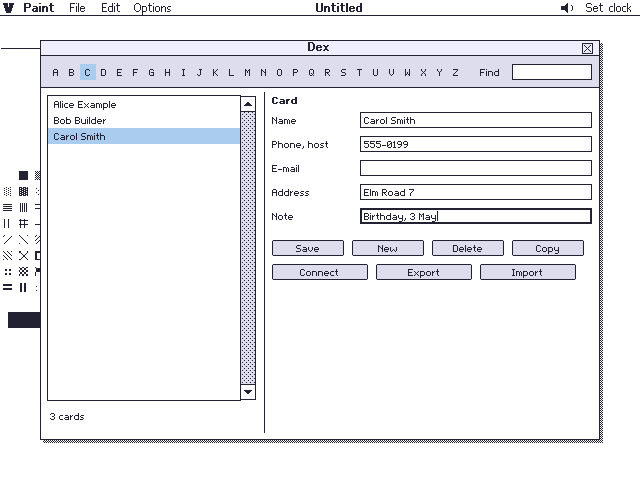

# Dex

Dex is an **address book**. It is a [desk accessory](Desk-accessories.md):
it opens over any program.

## A card

Each card has five fields: **name**, **phone** (a phone number, or a
BBS's `host:port`), **e-mail**, **address** and **note**. Cards are kept
in name order.

## Use it

- **Search**: type in the **Find** field at the top right. Dex shows
  the cards whose name, phone or e-mail holds the text, as you type.
- **The alphabet bar** at the top: click a letter to jump to the first
  name that starts with it.
- Click a card in the list to show it. Edit its fields in place. The
  scroll bar beside the list moves it: the arrows a card at a time, a
  click above or below the thumb a page.
- **Save** keeps the card (a new one, or the one selected).
- **New** empties the fields for a new card.
- **Delete** removes the card (after a question).
- **Copy** puts the card on Veranda's clipboard as text, a line per
  field.
- **Export** writes all cards to `DEX.CSV` (a header line, then a line
  per card) in the current folder. [Veranda Calc](Veranda-Calc.md) opens
  it. **Import** reads `DEX.CSV` and adds its cards.
- **Connect**: on a card whose phone field is a host (it has a letter,
  a dot or a colon), Dex asks, then starts [Term](Term.md) and connects
  to that host. The program under Dex is closed for this.

| Key | Action |
|---|---|
| Tab | move between the search field and the card's fields |
| Return | save the card |
| Up, Down | the previous, the next card in the list |
| Esc | close Dex |

## Where the cards are

In the file **Dex Cards** in `/VERANDA/.SYSTEM`.
