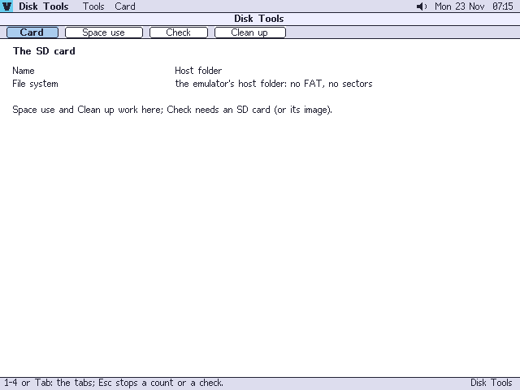
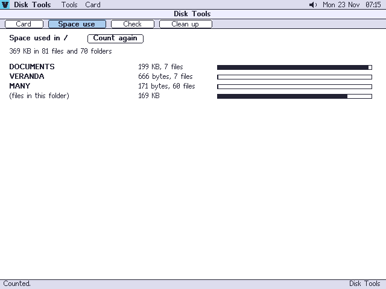
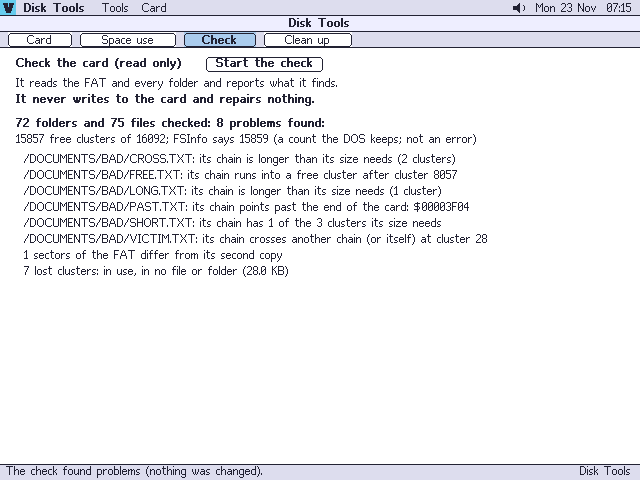
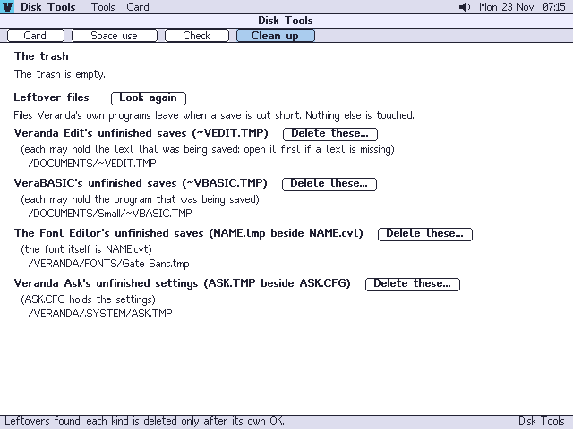

# Disk Tools

Disk Tools looks after the **SD card**: what it is, where its space
went, a check of its file system that **only reads**, and a clean-up of
the trash and of files that Veranda's programs leave behind. There is no
formatting: Veranda runs from this card.

## Start it

Double-click **Disk Tools** in `/VERANDA/APPS`. The four tabs in the
toolbar (or the keys **1** to **4**, **Tab** for the next, or the Tools
menu, which shows the keys) show its four pages. **Ctrl+Q** quits.

## Card

The card's name, the file system (FAT32), its size (the partition and
the whole card), the free space, the cluster size and count, the FATs.

**Rename...** gives the card a new name of up to 11 characters.

## Space use

The folders of a folder (the card's top first), each with the total size
of everything in it, the largest first, with a bar. The folder's own
files are on a line of their own.

- Click a folder (or select it with Up and Down and press Return) to
  look inside it. **Up** (or Backspace) goes back.
- Counting shows its progress in the status bar. **Esc** stops it (what
  was counted stays, marked as stopped). **Count again** counts afresh.

## Check (read only)

**Start the check** reads the FAT and every folder and reports what it
finds. **It never writes to the card and repairs nothing.** It finds:

- a chain of clusters that starts or points past the card's end;
- a cluster marked bad in a file;
- a chain that runs into a free cluster;
- chains that cross, or a chain that loops;
- a file whose chain is shorter or longer than its size needs;
- a folder that is too long (over 2 MB);
- places where the two copies of the FAT differ;
- lost clusters (in use, but in no file or folder).

The free count that the card keeps is shown beside the real one; a
difference there is not an error. **Esc** stops the check.

To repair a card, use a PC: `fsck` (Linux, macOS) or `chkdsk`
(Windows). A PC's check of the same card should agree with Disk Tools.

## Clean up

- **The trash**: its items are listed. **Empty the trash...** asks, then
  deletes everything in it for good.
- **Look for leftovers** walks the card for files that Veranda's
  programs leave when a save is cut short (for example by a power cut).
  They are listed kind by kind, and each kind is deleted **only after its
  own OK**:
  - `~VEDIT.TMP`: Veranda Edit's save in progress. It may hold the text
    that was being saved: open it in Veranda Edit first if a text is
    missing.
  - `~VBASIC.TMP`: VeraBASIC's, the same.
  - `NAME.tmp` beside `NAME.cvt`: the Font Editor's. (A `.tmp` with no
    `.cvt` beside it is not offered: it is the only copy.)
  - `ASK.TMP` beside `ASK.CFG`: Veranda Ask's. (A lone `ASK.TMP` holds
    the sign-in: not offered.)

  Nothing else is ever deleted.

## Alt+Tab

Disk Tools can be put aside at any time. A count or a check that is
running then stops (the card may change meanwhile) and says so when
you come back: start it again.

## Memory

On a 512 KB machine the check of a very large card may not have memory
for everything. It then still runs, but does not look for crossing
chains and lost clusters, and says so.
