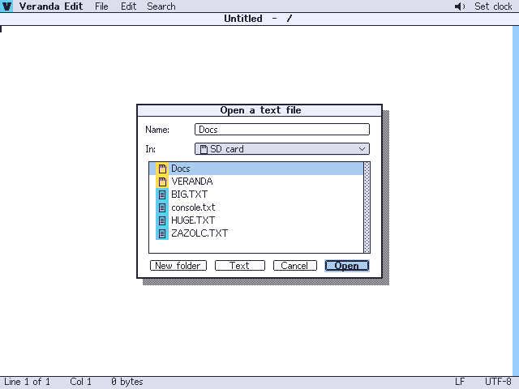

# Files and folders

Veranda works with the files on the SD card directly. The card is
FAT32, as on any PC.

## Where things are

| Folder | What is in it |
|---|---|
| `/DOCUMENTS` | **your files.** The desktop opens here. Programs save here first. |
| `/VERANDA/APPS` | the programs and desk accessories |
| `/VERANDA` | the system |
| `/VERANDA/.SYSTEM` | hidden: settings, saved servers, bookmarks, the trash, chats' settings |
| `/VERANDA/FONTS`, `/VERANDA/WALLPAPERS`, `/VERANDA/HELP` | fonts, desktop pictures, help |

**Disk > Documents** opens `/DOCUMENTS` again. The sidebar's places go
to Veranda (`/VERANDA`), Apps (`/VERANDA/APPS`), Documents and Mods
(your music folder, see below).

## Long names

Veranda shows and keeps long file names, up to 63 characters, such as
`Letter to the garden club.cwr`. Veranda's own programs open and save
long names. Older GEOS programs only see names of up to 16 characters.

GEOS documents and programs are stored as `.cvt` files on the card
(for example `Paint.cvt`). The desktop shows them without `.cvt`.

## The standard Open and Save box

Veranda's own programs use the same box to open and save files. It
shows the folders and files of one folder, with long names.

- Double-click a folder to go into it. **Backspace** goes up a folder
  (when opening).
- The **In:** pop-up lists the folders above, and Documents, Apps and
  the SD card.
- **New folder** makes a folder.
- A type button switches between the program's own files and **All
  files**.
- Up, Down, PgUp, PgDn, Home, End and the mouse wheel move the
  selection. When opening, typing a letter jumps to the next name with
  that letter.
- **Return**, the Open (or Save) button, or a double-click chooses.
  **Esc** or Cancel closes the box.

## Select, open, rename

- Click an icon to select it. **Select > First, Next, Previous, None**
  also select.
- **File > Open** opens the selection (as a double-click does).
- **File > Rename** asks for a new name.
- **File > Duplicate** makes a copy in the same folder.
- **File > Get info** shows a GEOS file's icon, name, type, class,
  author, date and size. You can edit its description and click OK to
  save it.

## Copy and move

- **Drag** a file onto the other window: it is **copied** there. Hold
  **Ctrl** or **Shift** while you drop to move it instead.
- **Drag** a file onto a folder's icon: it is **moved** into that
  folder. Hold **Ctrl** or **Shift** to copy instead.
- **Drag** a file onto the card's icon: it is copied to the card's top
  folder.
- Or select it and choose **File > Copy** or **File > Move**, go to
  another folder, and choose **File > Put here**. A copy into its own
  folder is named `Copy of ...`.

Whole folders can be copied and moved. A box shows the progress and has
a **Cancel** button. If you cancel in the middle of a file, that file
is deleted at the destination.

## The trash

- **File > Delete**, or dropping a file on the trash icon, moves it to
  the trash (after a Yes). The trash is the folder
  `/VERANDA/.SYSTEM/TRASH`. If a name is taken there, the file gets
  `~2`, `~3` ...
- **Disk > Trash**, or a double-click on the trash icon, shows what is
  in it. To get a file back, drag it out of the trash window.
- In the trash itself, **Delete** deletes for good.
- **Disk > Empty trash** deletes everything in it, for good.
  [Disk Tools](Disk-Tools.md) can also empty the trash.

## Find

**File > Find** searches for file names from the folder shown down,
through all its folders. Use `*` and `?` as wildcards (case does not
matter). Without them, any name that holds the text is found. Double-
click a result to open it, or show it in its folder, selected.

The **Search** field in a window's toolbar only searches the folder
shown.

## Print to PDF

Veranda prints to **PDF files**, not to a printer. Drop a BMP picture
(1, 4 or 8 bits a pixel, uncompressed, up to 640 x 480) or a Paint
picture on the **printer** icon, or select it and choose **File >
Print**. The PDF is written beside the picture, with the same name and
`.pdf` (A4, 150 dots an inch). Copy it to a PC to print it on paper.
Paint can also print with more choices: see [Paint](Paint.md).

Other documents need their own program's printing. Veranda Write
cannot print yet.

## The Mods folder

The sidebar's **Mods** place is your music folder. It is `/MODS` at
first. To use another folder, open it and choose **File > Set as Mods
folder**. [MOD Player](MOD-Player.md) starts there too.

## The card

The card's icon shows the card's name. The window's status bar shows
the free space. [Disk Tools](Disk-Tools.md) shows more, and can rename
the card.
