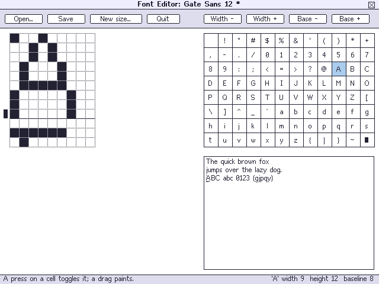

# FontEd

FontEd (the Font Editor) edits **GEOS fonts**: the fonts in
`/VERANDA/FONTS` that Veranda's programs use. You can change letters,
make a letter wider or narrower, move the baseline, and make a new size
from an existing one.

## Start it

Double-click **FontEd** in `/VERANDA/APPS`. It works in
`/VERANDA/FONTS`.

## The screen

- The title bar shows the font, its size, and a * when it has changed.
  Its close box quits, as **Quit** does.
- The buttons in the toolbar: **Open**, **Save**, **New size**, **Quit**;
  **Width - +** and **Base - +**.
- On the left, the letter in a large grid. The baseline row is marked.
- On the right, the 96 characters of the font. Click one to edit it.
- A **preview** in the font you edit, under the characters.
- The status bar at the bottom: a hint at the left, and the character's
  figures (its width, the height, the baseline) at the right.

## How to edit

- **Click a cell** in the grid to turn it on or off. **Drag** to paint:
  all cells you drag over get the value the first cell got.
- **Width -** takes a column from the letter's right side. **Width +**
  gives it one more.
- **Base -** and **Base +** move the baseline.
- **New size** asks for a point size. It scales the current size to it
  (nearest pixel). Then you edit the new size.
- **Open** shows the font picker: a font and a size.
- **Save** writes the font file.

## Files

Save writes a new file `Name.tmp` first, then deletes `Name.cvt` and
renames the new file. So there is always a good font file. If a save is
cut short, a `Name.tmp` may be left beside the font: [Disk
Tools](Disk-Tools.md) can delete it. After a save, every program sees
the new font.

## Tip

Keep a copy of a font before you change it.
