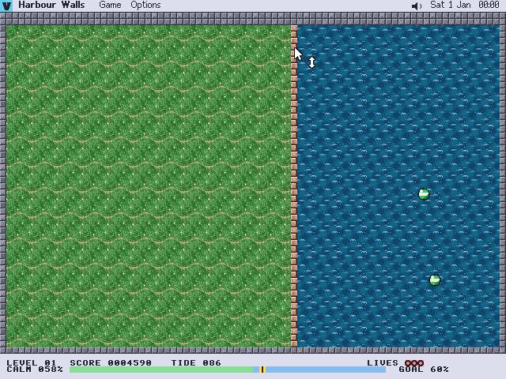

# Harbour Walls

Harbour Walls is an original game. Buoys drift around a harbour. You
build sea walls to fence off water that no buoy can reach, and that
water calms into land. Calm enough of the harbour to clear the level.
Version 1.0. MIT licence, Copyright (c) 2026 Marcin Spoczynski.

Harbour Walls is not built into every package. If it is not in
`/VERANDA/APPS`, copy `Harbour Walls.cvt` there.

## Start it

Double-click **Harbour Walls** in `/VERANDA/APPS`. **Harbour Walls >
How to play** explains the game.

## Controls

| Key or button | Action |
|---|---|
| Left click on the sea | start a wall |
| Right button or Space | turn the next wall (across or down) |
| P or Esc | pause |
| N, or a click | a new game (after a game ends) |
| Alt+N | a new game |
| Alt+H | high scores |
| Alt+S | sound on or off |
| Alt+Q | quit |

The pointer shows the direction of the next wall.

## Rules

- **A wall** grows from where you click, both ways at once, one block at
  a time. One arm is orange (left or up), the other purple (right or
  down).
- A buoy that touches a growing arm **breaks** that arm, and you lose a
  life. The other arm carries on.
- An arm that reaches stone (the quay, a wall or land) **sets**. Then all
  water no buoy can reach becomes land.
- **The goal**: calm 60% of the harbour on level 1, 5% more each level,
  80% at most. A cleared level gives back a life (up to 9). You start
  with 3 lives.
- **Buoys**: level n has n + 1 buoys. Green ones are slow, amber
  faster, red fastest.
- **Crates** (yellow) float up and sink after 15 seconds. Wall one in to
  collect it: a **bolt** (the next 3 walls grow 3 times faster), an
  **anchor** (all buoys stop for 4 seconds), a **ring** (an extra life),
  a **star** (points). A wall built over a crate sinks it.
- **The tide**: 90 seconds on level 1, 15 more each level, 240 at most.
  When it runs out, a storm makes every buoy faster.
- **Score**: each calmed block is worth the level number (double for a
  big capture of 400 blocks or more). A cleared level adds a bonus for
  the tide left and for every percent above the goal.

## High scores

Five entries (a name of up to 10 letters, the level, the score) are
saved in `/VERANDA/.SYSTEM/Harbour Walls Scores`.
