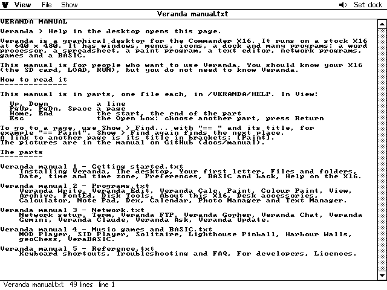

# Help on the X16

This manual is also on the SD card, as plain text, so you can read it
on the X16 itself.

## Open the manual

In the desktop choose **Veranda > Help**. [View](View.md) opens the
manual's first page, **Veranda manual.txt**: how to move around, and
the list of the manual's parts.

## Move around

The manual on the X16 has a few parts, one file each, in
`/VERANDA/HELP`:

| File | What is in it |
|---|---|
| `Veranda manual.txt` | the start page and the contents |
| `Veranda manual 1 - Getting started.txt` | installing, the desktop, your first letter, files, the clock, Preferences, BASIC |
| `Veranda manual 2 - Programs.txt` | the programs and desk accessories |
| `Veranda manual 3 - Network.txt` | the Wi-Fi card and the network programs |
| `Veranda manual 4 - Music games and BASIC.txt` | MOD Player, SID Player, the games, VeraBASIC |
| `Veranda manual 5 - Reference.txt` | keyboard shortcuts, troubleshooting, developers, licences |

In View:

| Key | Action |
|---|---|
| Up, Down | a line |
| PgUp, PgDn, Space | a page |
| Home, End | the start, the end of the part |
| **Esc** | the Open box with the manual's parts: choose another part and press Return |

To jump to a topic, use **Show > Find...**: for example, find
`== Paint` to go to Paint's page (each page starts with `==` and its
title). **Show > Find again** finds the next place.

The text version has no pictures. Links to other pages appear as their
title in brackets, for example `[Paint]`.

## VeraBASIC's help

VeraBASIC has its own help with links between pages: press **F1** in
the VeraBASIC editor. See [VeraBASIC](VeraBASIC.md).

## If Help does not open

- "View is not with the applications.": View is missing from
  `/VERANDA/APPS`. Copy it from the package.
- View says "Veranda manual.txt ... cannot be opened": the files are
  missing from `/VERANDA/HELP`. Copy that folder from the package.
- "Not enough memory": quit a program you put aside (right-click it in
  the dock, Quit), then try again.
