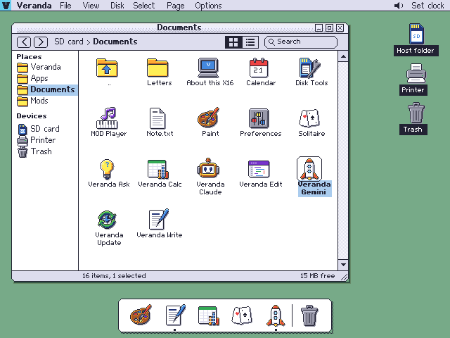

# The Veranda manual

Veranda is a graphical desktop for the Commander X16. It runs on a
stock X16 at 640 x 480. It has windows, menus, icons, a dock and many
programs: a word processor, a spreadsheet, a paint program, a text
editor, network programs, games and a BASIC.

This manual is for people who want to **use** Veranda. You should know
your X16 (the SD card, `LOAD`, `RUN`), but you do not need to know
Veranda.

## Start here

1. [Installing Veranda](Installing.md): the package on the SD card, the
   first start.
2. [The desktop](The-desktop.md): windows, menus, the dock, Alt+Tab.
3. [Your first letter](Your-first-letter.md): write, save and open a
   letter with Veranda Write.
4. [Files and folders](Files-and-folders.md): long names, copy, move,
   the trash, find.
5. [Date, time and time zone](Date-and-time.md): set the clock.
6. [Preferences](Preferences.md): themes, desktop pictures, sounds,
   the pointer.
7. [BASIC and back](BASIC-and-back.md): leave Veranda for BASIC and
   come back.
8. [Help on the X16](Help-on-the-X16.md): read this manual on the
   machine.

## The programs

| Kind | Programs |
|---|---|
| Writing | [Veranda Write](Veranda-Write.md) (the word processor), [Veranda Edit](Veranda-Edit.md) (plain text) |
| Numbers | [Veranda Calc](Veranda-Calc.md) (a spreadsheet), [Calculator](Calculator.md) |
| Pictures | [Paint](Paint.md), [Colour Paint](Colour-Paint.md), [View](View.md) |
| Organising | [Calendar](Calendar.md), [Dex](Dex.md) (addresses), [Note Pad](Note-Pad.md), [Photo and Text Manager](Photo-and-Text-Manager.md) |
| System | [Preferences](Preferences.md), [Disk Tools](Disk-Tools.md), [About this X16](About-this-X16.md), [Veranda Update](Veranda-Update.md), [Archive](Archive.md) (C64 GEOS disk images), [FontEd](FontEd.md) |
| Music | [MOD Player](MOD-Player.md), [SID Player](SID-Player.md) |
| Games | [Solitaire](Solitaire.md), [Lighthouse Pinball](Lighthouse-Pinball.md), [Harbour Walls](Harbour-Walls.md), [geoChess](geoChess.md) |
| Programming | [VeraBASIC](VeraBASIC.md) |

Small programs that open over other programs are called **desk
accessories**: see [Desk accessories](Desk-accessories.md).

## The network

Veranda can go online through TexElec's Serial & ESP32 Network Card
(a Wi-Fi modem).

- [Network setup](Network-setup.md): the card, Wi-Fi, TLS, security.
- [Term](Term.md): a terminal for BBSes and Telnet.
- [Veranda FTP](Veranda-FTP.md), [Veranda Gopher](Veranda-Gopher.md),
  [Veranda Chat](Veranda-Chat.md) (IRC), [Veranda Gemini](Veranda-Gemini.md)
  (Gemini, web pages, Wikipedia).
- [Veranda Claude](Veranda-Claude.md) and [Veranda Ask](Veranda-Ask.md):
  chat with AI models.
- [Veranda Update](Veranda-Update.md): bring the card up to date.

## Reference

- [Keyboard shortcuts](Keyboard-shortcuts.md): every key in one page.
- [Troubleshooting and FAQ](Troubleshooting.md): when something does
  not work.
- [For developers](For-developers.md): the SDK and the source.
- [Licences](Licences.md): Veranda's licence and the other programs'.

## About this manual

This manual describes **Veranda 1.0** (November 2026), with the
**Sunroom** look (the default style).

Veranda is MIT-licensed. Copyright (c) 2026 Marcin Spoczynski.
