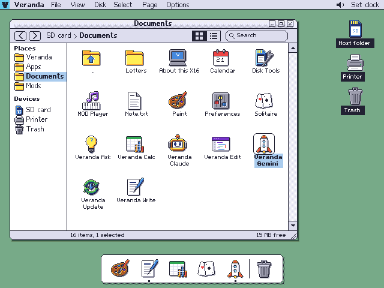

# Installing Veranda

## What you need

- A Commander X16 with at least **512 KB** of banked RAM (a stock
  machine). 2 MB gives more room for programs and documents.
- The X16's SD card, formatted FAT32 (as it comes).
- A mouse. Most of Veranda needs one.
- The **Veranda package**: a folder with `VERANDA`, `DOCUMENTS` and `PC`
  in it. You can build one from the source with `tools/mkdist.sh` (see
  [For developers](For-developers.md)).
- For the network programs: TexElec's Serial & ESP32 Network Card. See
  [Network setup](Network-setup.md).

## Copy the package to the SD card

Put the SD card in your PC. Copy the package's folders to the **top
level** of the card:

| Folder | What is in it |
|---|---|
| `/VERANDA` | the system: `VERANDA.PRG`, `AUTOBOOT.X16` (the same program, for `BOOT`), `VERANDA.SYS`, `RBOOT`, `SHELL.cvt` (the desktop), Veranda Setup, `README.txt`, `UPDATE.LST` |
| `/VERANDA/APPS` | the programs and desk accessories |
| `/VERANDA/FONTS` | the fonts: Gate Sans, Gate Mono 10 and 12 |
| `/VERANDA/WALLPAPERS` | desktop pictures: Dusk, Still Water, Low Hills and Sunroom Tiles |
| `/VERANDA/DICT` | Veranda Write's spelling code; its dictionaries go here too when you get them (Tools > Get dictionaries) |
| `/VERANDA/TEMPLATES` | Veranda Write's templates, English (`EN`) and Polish (`PL`) |
| `/VERANDA/HELP` | VeraBASIC's help, this manual in text form, the VeraBASIC reference card (PDF) |
| `/DOCUMENTS` | your files. The desktop opens here and programs save here. The package puts the VeraBASIC examples here. |
| `/PC` | small Python programs that run **on a PC**, not on the X16: helpers for Veranda Claude, Ask, Gemini and Update |

Veranda makes one more folder by itself: `/VERANDA/.SYSTEM`. It is
hidden. It keeps your settings, alarms, the clipboard, the Note File,
the trash, saved servers and bookmarks.

Your own files and folders on the card stay where they are.

## Start Veranda

Put the card back in the X16 and turn it on. At the `READY.` prompt
type:

    DOS"CD:VERANDA"
    BOOT

`BOOT` runs `AUTOBOOT.X16` in that folder. You can also type
`LOAD"VERANDA.PRG"` and then `RUN`.

Veranda plays a short sound and shows the desktop, with a window on
`/DOCUMENTS`.

## The first start

- On the first start, the desktop runs **Veranda Setup** once. On a new
  card it only writes a log. On a card with an older Veranda it moves
  the files into the new folders (see below).
- If the X16's clock was never set, the menu bar shows **Set clock** at
  the right. Click it and set the date and time: see
  [Date, time and time zone](Date-and-time.md).
- The default look is **Sunroom**: mist-white title bars, a sage-green
  desktop and sky-blue selections. You can change it in
  [Preferences](Preferences.md).

(In the emulator the card's icon at the top right says "Host folder".
On a real X16 it shows the card's name.)

## A card with an older Veranda

Older Veranda builds kept everything in `/VERANDA`. To update such a
card:

1. Copy the package's `VERANDA` folder over the card's `VERANDA`
   folder (replace the files).
2. Copy the package's `DOCUMENTS` folder to the top of the card.
3. Start Veranda. Veranda Setup runs once:
   - settings, the Note File, scraps and the trash go to
     `/VERANDA/.SYSTEM`;
   - programs go to `/VERANDA/APPS` (an old copy of a program that is
     already there goes to `/VERANDA/.SYSTEM/OLD`);
   - fonts go to `/VERANDA/FONTS`;
   - your documents (`.cvt` documents, `.TXT`, `.BMP`, `.MOD` ...) go
     to `/DOCUMENTS`. If a name is taken there, the file gets `~2`.

Programs (`.PRG`) and your own folders stay where they are. **Nothing
is deleted.** The list of what moved where is in
`/VERANDA/.SYSTEM/LAYOUT.LOG`.

To update a card that already has the new folders, you can also use
[Veranda Update](Veranda-Update.md).

## Next

- [The desktop](The-desktop.md)
- [Your first letter](Your-first-letter.md)
