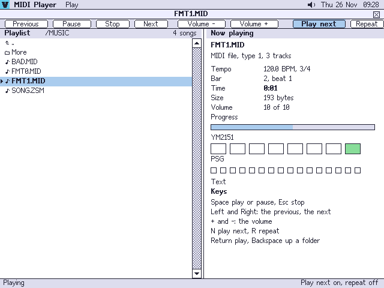

# MIDI Player

MIDI Player plays **MIDI files** (`.MID`, `.MIDI`) on the X16's YM2151
sound chip and **ZSM files** (`.ZSM`, the X16's own music format, from
Furnace and other trackers) on the YM2151 and VERA's sound generator.
The music keeps playing while menus and boxes are open and while the
window is drawn. Version 1.0. Its MIDI engine is MooingLemur's
**Melodius**, its ZSM engine MooingLemur's **ZSMKit**; the window is
Veranda's. MIT licence.

It is in `/VERANDA/APPS` as `MIDI Player.cvt`.

## Start it

- Double-click a `.MID`, `.MIDI` or `.ZSM` file: MIDI Player plays it,
  with its folder as the playlist.
- Or double-click **MIDI Player** in `/VERANDA/APPS`: it opens in the
  folder you were in (in `/DOCUMENTS` when that was a folder of
  Veranda's own), and you go to your music in its playlist.

## The window

- **The toolbar**: Previous, Play (Pause while a song plays), Stop,
  Next, Volume - and Volume +, **Play next** and **Repeat** (each
  highlighted while it is on).
- **The playlist**: the folder's folders, then its MIDI and ZSM files,
  `..` to go up. Double-click a song to play it, a folder to open it.
  The song playing is marked and bold.
- **Now playing**: the song's name; its kind (a MIDI file's type and
  tracks; whether a ZSM loops); for MIDI the tempo in beats a minute
  and the time signature, the bar and beat; for ZSM its tick rate and
  how many times it has played; the time; the size; the volume; a
  progress bar (how far into the file it is); the YM2151's eight
  channels and the PSG's sixteen voices, lit while they sound; a MIDI
  file's text (lyrics) as it comes.
- The status bar: Playing, Paused, Stopped, Loading... or what went
  wrong on the left; Play next and Repeat on the right.

## Menus

| Menu | Items |
|---|---|
| MIDI Player | About MIDI Player..., Quit |
| Play | Play or pause, Stop, Next, Previous, Volume up, Volume down, Play next: on/off, Repeat: on/off |

## Keys

| Key | Action |
|---|---|
| Space | play or pause (stopped: play the song chosen) |
| Esc | stop |
| Right | the next song |
| Left | the previous song |
| + (or =), - | the volume up, down |
| N | Play next on or off |
| R | Repeat on or off |
| Up, Down | move the selection |
| PgUp, PgDn | move the selection 24 rows |
| Home, End | the first, the last entry |
| Return | open the folder, or play the song |
| Backspace | up a folder |
| Ctrl+Q or Alt+Q | quit |

The mouse: the toolbar's buttons, the playlist (double-click), the
scroll bar, the wheel (3 rows), the close box.

## Play next, Repeat, the volume

- **Play next** (on at first): when a song ends, the next one in the
  list plays. After the last song it stops.
- **Repeat** (off at first): the same song plays again when it ends.
  A ZSM that loops goes on looping.
- A ZSM that loops is played once round, then faded out, unless Repeat
  is on.
- Next and Previous (the buttons, the keys) wrap at the ends of the
  list. A song that does not load is passed over, and its error shown.
- **The volume** goes from 10 (full) to 0 (silent), 3 dB a step. It
  stays as set for the next songs.

## Alt+Tab and quitting

- **Alt+Tab** pauses the music: a program put aside does not run, so
  it cannot play. When you come back to MIDI Player, the song goes on
  from where it was.
- **Quit** (the close box, Ctrl+Q) stops the music and silences every
  YM2151 channel and every voice MIDI Player used.

## How MIDI sounds

- MIDI files of **type 0 and type 1** play, with up to **32 tracks**
  and ticks per quarter note (not SMPTE time).
- The instruments are the **General MIDI** sounds of the X16's ROM, on
  the YM2151's **eight channels**; channel 10's notes are the ROM's
  drums. A song with more than eight notes at once has some notes cut
  short or left out, the oldest first.
- Notes, program changes, volume (controller 7), pan, the sustain
  pedal, the modulation wheel, pitch bend and its range, tempo and time
  signature changes are played; aftertouch and SysEx messages are
  skipped.
- A note held when you pause is not sounded again when you go on: the
  song goes on with its next notes.

## Notes and limits

- A song is read whole into the RAM banks: on a 512 KB X16 up to about
  280 KB, more with more memory. A larger one says "Too big for the
  free memory".
- A ZSM song may use all sixteen PSG voices; voices 14 and 15 are also
  Veranda's system sounds'. A system sound (a beep) while a ZSM plays
  takes them for its length, and the song's notes on them come back
  with their next note.
- It does not open `.ZCM` files (sampled sound): [VIDKIT
  Player](VIDKIT-Player.md) plays those.
- It plays on the X16's own sound chips; it does not send MIDI to a
  MIDI card.
- Up to 255 entries in the playlist. A name longer than 62 characters is
  listed but cannot be played.

## Credits

The MIDI engine is **Melodius**'s and the ZSM engine is **ZSMKit**, both
by **MooingLemur** ([github.com/mooinglemur/melodius](https://github.com/mooinglemur/melodius),
[github.com/mooinglemur/ZSMKit](https://github.com/mooinglemur/ZSMKit)),
MIT licence, Copyright (c) 2023 MooingLemur. Veranda's MIDI Player
keeps their notices in its source (`apps/midiplay/vendor`). The
playlist follows [MOD Player](MOD-Player.md)'s. See
[Licences](Licences.md).
