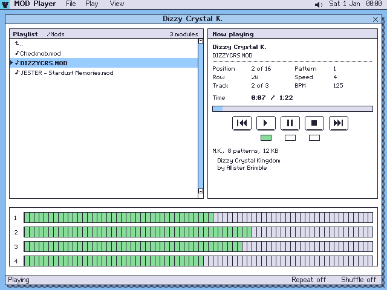

# MOD Player

MOD Player plays **ProTracker modules** (4-channel `.MOD` files) at
16 kHz stereo through VERA's audio. The music keeps playing while menus,
boxes and desk accessories are open. Version 1.2, from the x16-mod
project. MIT licence, Copyright (c) 2026 Marcin Spoczynski.

## Start it

- Double-click a `.MOD` file: MOD Player plays it, with its folder as
  the playlist.
- Double-click **MOD Player** in `/VERANDA/APPS`: it starts in your
  **Mods folder** (`/MODS` at first; see
  [Files and folders](Files-and-folders.md#the-mods-folder)).

## The window

- **The playlist**: folders and modules, `..` to go up. Double-click a
  module to play it. The one playing is marked.
- **Now playing**: title, position, pattern, row, speed, track, BPM,
  time, the song's length, a progress bar.
- **Buttons**: previous, play, pause, stop, next.
- **Four VU meters**.
- **View > Pattern view** shows the notes instead of the playlist.
- The status bar: Playing, Paused or Stopped; repeat and shuffle.

## Menus

| Menu | Items |
|---|---|
| MOD Player | About MOD Player, the desk accessories |
| File | Open..., Play all (the folder from its first module), Quit |
| Play | Play/Pause, Stop, Next, Previous, Repeat: off/on, Shuffle: off/on |
| View | Pattern view, Playlist |

## Keys

| Key | Action |
|---|---|
| Space | play or pause |
| Right | the next module |
| Left | the previous module |
| Esc | stop |
| Alt+O | Open... |
| Alt+Q | quit |
| Up, Down | move the selection |
| PgUp, PgDn | move the selection 15 rows |
| Home, End | the first, the last entry |
| Backspace | up a folder |
| Return | open the folder, or play the module |

The mouse: the playlist (double-click), the scroll bar, the wheel (3
rows), the buttons, the close box.

## Notes

- Next and Previous wrap at the ends of the list. A module that does
  not load is skipped, and its error is shown.
- Shuffle never picks the module that is playing.
- While music plays, the player uses about three quarters of the CPU:
  other things are slower.
- The music stops when MOD Player quits.
- Up to 255 entries in the playlist.
