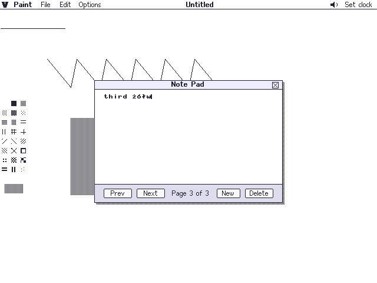

# Note Pad

Note Pad keeps pages of short notes, as GEOS's note pad did. It is a
[desk accessory](Desk-accessories.md): it opens over any program.

## Use it

- Each page holds up to 640 characters (36 columns, 18 rows). Text
  wraps at the window's edge.
- The title bar has the close box at its right. The bar at the bottom
  has **Prev** and **Next**, the page ("Page 2 of 5"), **New** and
  **Delete**.

| Key | Action |
|---|---|
| typing, Return, Backspace, Delete, arrows | write and edit |
| PgUp, PgDn | the previous, the next page. PgDn on the last page makes a new page (unless the page is empty). |
| Ctrl+N | a new page after this one |
| Ctrl+D | delete this page |
| Esc | close Note Pad |

## Where the notes are

All pages are in one file, the **Note File**, in `/VERANDA/.SYSTEM`. Up
to 127 pages. A page is saved when you turn it or close the pad, if it
changed.
