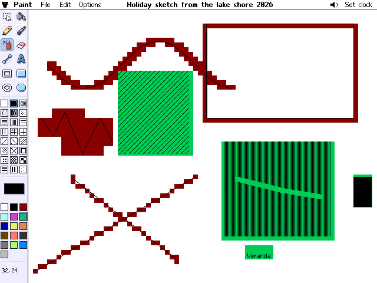

# Paint

Paint is a drawing program in the style of geoPaint: black lines and
patterns, with colour added by 8 x 8 blocks. Pictures are 592 x 464
pixels.

## Start it

- Double-click **Paint** in `/VERANDA/APPS`.
- Double-click a Paint picture: Paint opens it.

## The screen

- **The menu bar**: Paint, File, Edit, Options, and the picture's name.
- **The column** on the left:
  - **the tools**, two a row: **selection**, **fill**, **pencil**,
    **brush**, **spray**, **eraser**, **line**, **text**, **rectangle**,
    **filled rectangle**, **oval** and **filled oval**. The chosen tool
    sits on a blue plate.
  - **the patterns**: 24 patterns. The chosen one has a blue ring.
  - **the current pattern on the current colour**, as it will look in
    the picture.
  - **the colours**: click one to make it the current colour.
  - **the status**: where the pointer is in the picture (in pixels from
    its top left) and, while you drag out a shape or a selection, its
    width and height.
- **The drawing area**: the rest of the screen.

## The tools

- **Selection**: drag out an area. It snaps to whole 8 x 8 blocks.
  Then use Cut, Copy or Paste in the Edit menu.
- **Fill**: click in an area of paper. The area around the click, up to
  the ink, gets the current pattern. A large area full of patterns can
  take a few seconds; the pointer shows that Paint is busy.
- **Pencil**: draw thin lines as you drag.
- **Brush**: paint the current pattern with a round tip as you drag.
- **Spray**: hold the button down to spray dots around the pointer.
- **Eraser**: rub out as you drag.
- **Line**: drag from one end to the other.
- **Text**: click where the text goes and type a line (up to 40
  characters), then press Return.
- **Rectangle** and **oval**: drag a frame.
- **Filled rectangle** and **filled oval**: drag a shape filled with the
  current pattern.

## Colour

The X16's 640 x 480 screen has **one ink colour** and **one paper
colour for each block of 8 x 8 pixels**. So in Paint:

- the drawing tools give the blocks they touch the **current colour**
  as their paper colour. Colour 0 is the normal paper.
- **Options > Ink colour** makes the current colour the ink colour of
  the whole picture (black at first).

## Menus

| Menu | Items |
|---|---|
| Paint | About Paint, Desk accessory... |
| File | New (Ctrl N), Open... (Ctrl O), Save (Ctrl S), Save as..., Export..., Print... (Ctrl P), Quit (Ctrl Q) |
| Edit | Clear, Invert, Select, Cut (Ctrl X), Copy (Ctrl C), Paste (Ctrl V) |
| Options | Ink colour, Text font... |

- **Edit > Clear** empties the picture. **Invert** turns ink pixels to paper and paper pixels to ink.
- **Edit > Select** gives you the selection tool (the first tool in the
  column): drag out an area (it snaps to whole 8 x 8 blocks). **Cut**
  and **Copy** put it on Veranda's
  clipboard (with its colours). **Paste** shows the clipboard's picture
  floating under the pointer; click to put it down.
- **Options > Text font...** chooses the font of the text tool from the
  fonts in `/VERANDA/FONTS`.

The menus show their keyboard shortcuts. The tools are chosen with the
mouse.

## Files

- **Save** and **Save as** write a Paint picture (a GEOS document,
  `Name.cvt` on the card). The first Save goes to `/DOCUMENTS`. Long
  names are fine.
- **Export...** writes the picture as a BMP file (4 bits a pixel, with
  its colours) for a PC. `.bmp` is added if the name has no dot.
- **Print...** writes the picture to a **PDF** file: first a box for the
  page (A4 or US Letter) and the size (fit to the page, or 80 pixels an
  inch), at 150 dots an inch, in colour. `.pdf` is added if the name has
  no dot. Print the PDF on a PC.
- You can also drop a Paint picture on the desktop's printer icon.
- [Colour Paint](Colour-Paint.md) opens Paint pictures too, and its
  Export for Paint writes them.
- [View](View.md) shows Paint pictures. [Archive](Archive.md) turns C64
  geoPaint pictures into Paint pictures.

## Limits

- One ink colour a picture; one paper colour for each 8 x 8 block.
- No undo.
- The Open box lists the GEOS files (`.cvt`) of a folder. A file that is
  not a Paint picture is refused when you open it.
