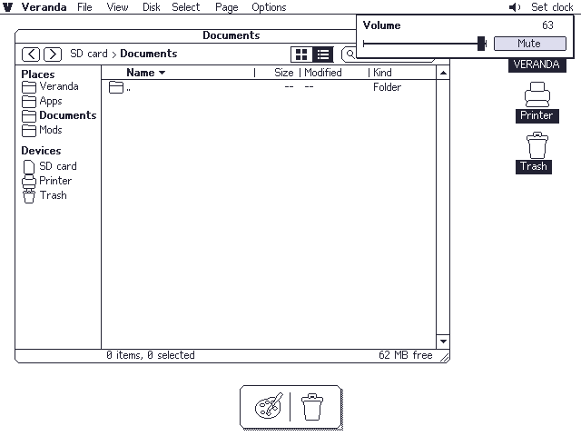
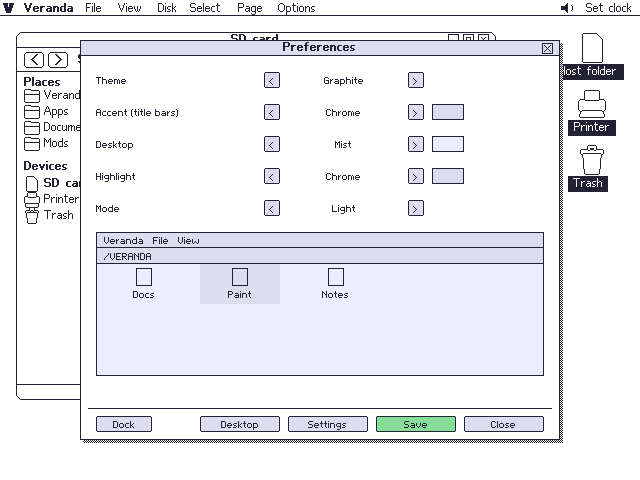
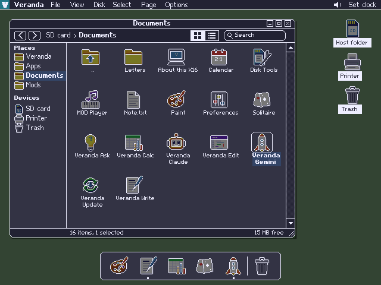
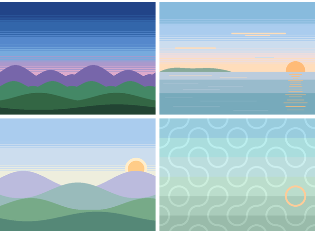
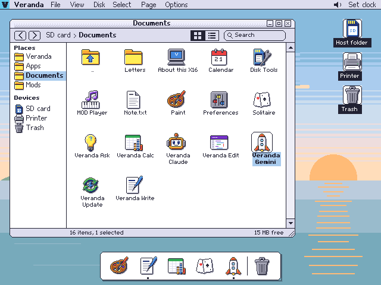
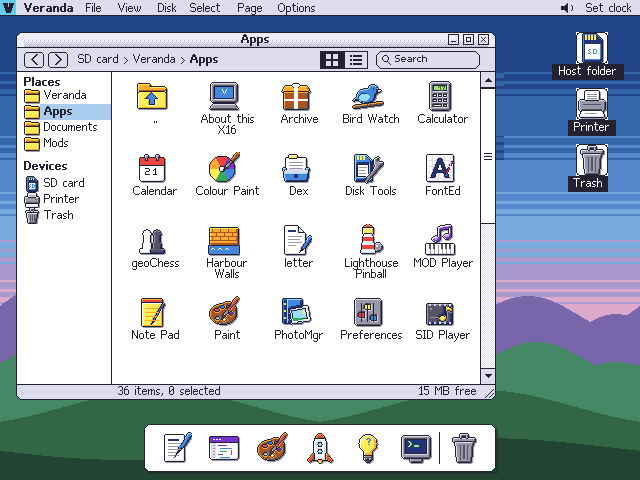

# Preferences

Preferences is Veranda's control panel. It is a desk accessory, so it
opens over any program.

## How to open it

- In the desktop: **Options > Preferences...**, or **Veranda > Desk
  accessory**, then **Preferences**.
- In most programs: the first menu, **Desk accessory...**.
- Double-click **Preferences** in `/VERANDA/APPS`.
- Click the **date and time** in the menu bar: Preferences opens at the
  Date and Time rows.
- Click the **speaker** in the menu bar: only the volume slider opens.

Preferences has four pages: **Settings**, **Theme**, **Desktop** and
**Dock**.
The buttons at the bottom switch between them. **Save** keeps your
changes. **Close** without Save leaves everything as it was.

## The Settings page

Each row has **<** and **>** buttons to change it.

| Row | Choices |
|---|---|
| Blank the screen after | never, 1, 2, 5, 10, 15, 30 minutes, 1 hour. The screen goes dark when you do nothing for that long. Move the mouse or press a key to wake it. |
| Paper | the background colour of windows and pages: White, Cream, Mint, Sky, Silver, Sand |
| Ink | the colour of text and lines: Slate, Black, Navy, Brown, Forest, Plum |
| Sounds | **On** or **Off**; the volume, 0 to 63; **Menu ticks** (a small click when you choose a menu item) or **No menu ticks** |
| Pointer speed | Normal, Fast, Faster |
| Video mode, switching | the video mode at start: 640 x 480, 640 x 240, 320 x 240, or "as it is"; and where Alt+Tab puts a program aside: **Programs aside: card** (Roomy: in RAM when it fits, else on the SD card, so programs may use nearly all the memory; the default below 2 MB) or **Programs aside: RAM** (Fast: always in RAM, so Veranda keeps memory free; the default with 2 MB) |
| Desktop | the desktop program Veranda starts. Veranda's shell is the normal one. |
| Time zone | your distance from UTC: see [Date, time and time zone](Date-and-time.md) |
| Date, Time | the clock: see [Date, time and time zone](Date-and-time.md) |

Blanking, the sounds and the pointer speed change at once when you
save. The paper, the ink and the video mode apply from the next program
that starts.

Veranda keeps the settings in `/VERANDA/.SYSTEM/Veranda Prefs` and reads
them every time it starts.

### The volume slider

Click the speaker in the menu bar. A small box opens under it: drag or
click the **Volume** slider (0 to 63), or use the mouse wheel or the
arrow keys. **Mute** turns all system sounds off. Every change plays a
short sound. Click outside the box, or press Esc or Return, to close it.
The speaker in the menu bar is crossed out when the sounds are muted.

## The Theme page

The theme sets the colours of Veranda's own programs.

| Row | What it does |
|---|---|
| Theme | a ready set of colours: **Sunroom** (the default), Classic, Graphite, Mint, Veranda. It shows **Custom** when you change a colour. |
| Accent (title bars) | the colour of title bars |
| Desktop | the colour behind the windows |
| Highlight | the colour of selections and of an open menu |
| Mode | **Light** or **Dark** |

The colours you can choose: None, Sky, Blue, Azure, Cyan, Green, Yellow,
Orange, Rose, Lilac, Dusk, Chrome, Mist, Sage. A small preview shows a
desktop in your colours.

- **Sunroom** has mist-white title bars, a sage-green desktop and
  sky-blue selections.
- **Classic** has no colours: black and white, as GEOS had.
- **Dark** mode swaps the whole palette at once: light text on dark
  windows.

## The Desktop page

This page sets what is behind the windows.

| Row | What it does |
|---|---|
| Background | **Picture**, **Plain colour** (the theme's desktop colour: the default) or **Pattern** (one of eight GEOS patterns) |
| Picture | **Choose** opens the pictures in `/VERANDA/WALLPAPERS`: **Dusk**, **Still Water**, **Low Hills** and **Sunroom Tiles** |
| Pattern | the pattern's number |
| Colour | the colour |

In dark mode a picture shows its dark version by itself: Still Water
and Low Hills turn to night, with the moon in place of the sun. The
icons keep their colours on a picture: the desktop's own icons sit on
small white plates.

All four pictures are made of few, large shapes, so they leave room for
every program's colour icon.

If the chosen picture is no longer in `/VERANDA/WALLPAPERS` (for
example **Meadow**, which earlier versions had), the desktop shows the
plain colour instead. Your setting is kept; choose another picture in
Preferences to change it.

You can turn your own picture into a desktop picture with the SDK's
`tools/mkwall.py` on a PC, and copy the file into
`/VERANDA/WALLPAPERS`. See [For developers](For-developers.md). A
picture made with an older `mkwall.py` shows the icons as plain tiles:
make it again to get the colour icons.

The desktop takes the new background when Preferences closes. The
setting is kept in `/VERANDA/.SYSTEM/WALLPAPER.CFG`.

## The Dock page

This page lists the programs pinned to the desktop's **dock**, in their
order, up to 10. Click one to select it.

| Button | What it does |
|---|---|
| Add... | lists the programs in `/VERANDA/APPS`; click one to add it at the end (click anywhere else to go back) |
| Remove | takes the selected program out of the dock (the program itself stays) |
| Move up, Move down | moves the selected program one place towards the start or the end of the dock |

**Save** keeps the list. The dock shows it when Preferences closes, and
after a restart. The list is kept in `/VERANDA/.SYSTEM/SHELL.DSK`, with
the desktop's windows. You can also arrange the dock by dragging its
icons: see [The desktop](The-desktop.md).

## System sounds

With sounds on, Veranda plays: a chime at start, a sound when a program
starts, when a desk accessory opens and closes, when a question box
opens, a beep for errors, the alarm, a crunch when the trash is
emptied, and (if you want them) menu ticks. They use two of the PSG's
voices.
