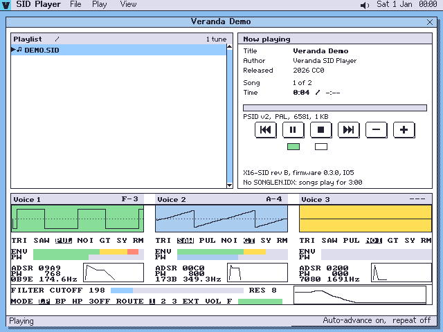

# SID Player

SID Player plays **SID tunes** (C64 music, `.SID` files) on a real SID
chip, on the **X16-SID card** (the CommanderSID project's card). The
card's own player runs the tune; the X16 shows what the chip does.
Version 1.1, a port of CommanderSID's player. GPL-3.0-or-later.

**You need the X16-SID card.** Without it, SID Player says "No X16-SID
card found" and can only show folders. It looks for the card at IO5
(`$9FA0`), then IO6 (`$9FC0`).

SID Player is not built into every package. If it is not in
`/VERANDA/APPS`, copy `SID Player.cvt` there.

## Start it

- Double-click a `.SID` file.
- Or double-click **SID Player** and choose a tune in its playlist.

## The window

- **The playlist**: folders first, then `.SID` files.
- **Now playing**: title, author, year, song x of y, time and length, a
  progress bar, PSID or RSID, PAL or NTSC, 6581 or 8580, the size.
- **Buttons**: previous tune, play/pause, stop, next tune, song -,
  song +.
- **The voices**: for each voice a scope, the note, the waveform, the
  envelope, and the filter.
- **View > Tracker** shows the notes as they start.

## Menus and keys

| Menu | Items |
|---|---|
| SID Player | About SID Player, the desk accessories |
| File | Open..., Find the card, Quit |
| Play | Play/Pause, Stop, Next tune, Previous tune, Next song, Previous song, Auto-advance: on/off, Repeat: off / folder / song |
| View | Playlist, Tracker |

| Key | Action |
|---|---|
| Space | play or pause |
| Right or N | the next tune |
| Left or P | the previous tune |
| Esc or S | stop |
| + or = | the next song in the tune |
| - | the previous song |
| 1 to 9 | play that song number |
| A | auto-advance on or off |
| R | repeat: off, folder, song |
| T | playlist or tracker |
| Alt+O | Open... |
| Alt+Q or Q | quit |
| Up, Down, PgUp, PgDn, Home, End | move the selection |
| Backspace | up a folder |
| Return | open the folder, or play the tune |

## Song lengths and RSID tunes

- **Auto-advance** (on at first) goes to the next song when the time is
  up, then to the next tune. Without song lengths, a song plays 3:00.
- `SONGLEN.IDX` gives the real lengths (from HVSC's song length list).
  Put it in the tune's folder, the card's top folder or the player's
  folder. CommanderSID's tools make it.
- **RSID** tunes need `C64ROMS.BIN`: your own C64 ROM images (exactly
  20 KB), in the card's top folder or the player's folder. Veranda does
  not include them.

## Limits

- A tune may be up to 64 KB. Up to 512 entries in the playlist.
