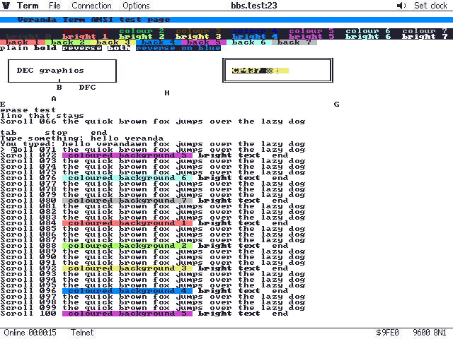
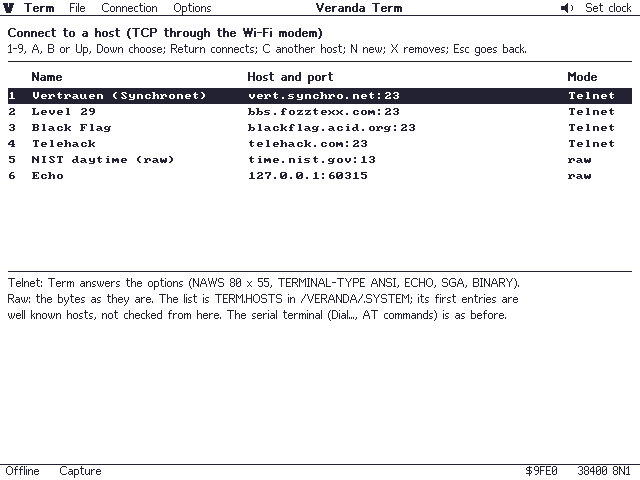
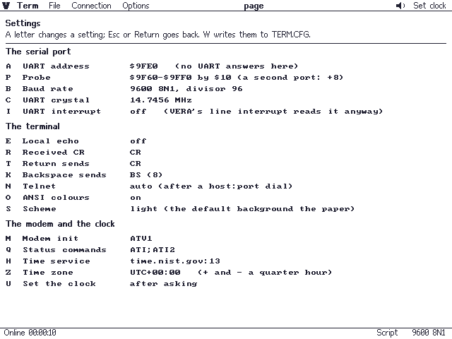

# Term

Veranda Term is a **terminal**: for Telnet BBSes and other text
services on the Internet, through the Wi-Fi modem (see
[Network setup](Network-setup.md)). It shows ANSI colours, keeps a
scrollback, captures text to a file and downloads files with XMODEM.
It is also the place to type AT commands to the modem.

## Start it

- Double-click **Term** in `/VERANDA/APPS`.
- Double-click a `.TEL` file (a line `name|host:port`): Term connects
  to that host.
- [Dex](Dex.md)'s **Connect** starts Term with a card's host.

## The window

The BBS or host's name in the menu bar, 80 x 55 characters, and a status
bar at the bottom. On its left: Offline, Dialling or Online and the time
online (in a TCP session, the host and port first), then Telnet or Raw
TCP, Local echo, Capture, Sending a file, the XMODEM block, and
"Back n of m" in the scrollback. On its right: the card's address (or
Script) and the line, for example `$9FE0    9600 8N1`.

The 80 columns fill the screen, so the scrollback has no scroll bar: use
PgUp and PgDn.

## Connect to a host

**Connection > Connect...** opens the **Hosts** page: up to 11 hosts,
each with a name, `host:port` and a mode, **Telnet** or **raw** TCP.

| Key | Action |
|---|---|
| 1-9, A, B, or Up and Down | choose a host |
| Return | connect |
| C | connect to another host (host, port: 23 if empty, T or R) |
| N | add a host |
| X | remove the chosen host |
| Esc | back |

The first time the list has five well-known hosts: Vertrauen, Level 29,
Black Flag, Telehack, and NIST's time service. They were written from
memory and **not checked** from here. The list is kept in
`/VERANDA/.SYSTEM/TERM.HOSTS`.

**Connection > Disconnect** ends the session.

## The address book and the modem

- **Connection > Dial...** dials `host:port`, or sends an AT command as
  it is.
- **Connection > Address book**: eight well-known Telnet BBSes (from
  memory: check them) and eight of your own (N new, E edit, X delete).
  Kept in `TERM.BOOK`.
- **Connection > Modem status** sends the status commands (`ATI;ATI2`
  at first).
- When not connected, what you type goes to the modem: type `ATI` to see
  its version, `AT+CONFIG` for Zimodem's Wi-Fi setup.

## Menus

The menus are in groups, and show their keys at the right.

| Menu | Items |
|---|---|
| Term | About Term; Desk accessory...; Quit (Alt+Q) |
| File | Capture on/off, Send text file... (raw); XMODEM download... (Alt+X) |
| Connection | Connect..., Dial... (Alt+D), Address book; Disconnect / hang up (Alt+H); Modem status, Clock from network |
| Options | Settings...; Clear screen, Copy screen (the window's text to the clipboard) |

## Keys

Almost every key goes to the host: the arrows, Home, End, Insert,
Delete and F1-F4 as VT100/xterm sequences; Ctrl + a letter as its
control code; STOP as Ctrl+C.

| Key | Action |
|---|---|
| PgUp, PgDn | move through the scrollback (816 lines); any other key comes back |
| F7 | the session menu: D hang up, X download, C capture, Q quit |
| Alt+D | dial |
| Alt+H | hang up |
| Alt+X | XMODEM download |
| Alt+Q | quit |

## Settings

**Options > Settings** is a page in the window, in three groups (the
serial port, the terminal, the modem and the clock): press a letter to
change a line, **W** to write the settings (`TERM.CFG`), **Esc** to go
back.

| Key | Setting | Default |
|---|---|---|
| A, P | the card's address; P looks for the card | `$9FE0` |
| B | the baud rate (300 to 115200) | 9600 |
| C | the card's crystal | 14.7456 MHz (TexElec's card) |
| I | the card's own interrupt | off |
| E | local echo | off |
| R | a received CR as CR or CR LF | CR |
| T | Return sends CR, CR LF or LF | CR |
| K | Backspace sends BS or DEL | BS |
| N | Telnet: auto, always, never | auto |
| O, S | ANSI colours; the light or dark scheme | on, light |
| M | the modem's init string | `ATV1` |
| Q | the status commands | `ATI;ATI2` |
| H, Z, U | the time server; the time zone; set the clock without asking | `time.nist.gov:13`, UTC, off |

## Set the clock from the Internet

**Connection > Clock from network** asks the time server (NIST's at
first), adds Term's time zone (setting Z, in quarter hours) and, after
you click Yes, sets the X16's clock. Set Term's time zone to yours first.

## Limits

- Colours: Veranda's screen has one ink colour and one paper colour per
  character cell. Coloured text on a black background looks as on a PC;
  on a coloured background the text is black. Underline and blink are
  not shown.
- No PETSCII mode, no UTF-8, no XMODEM upload, no ZMODEM.
- With 512 KB, Term's scrollback (16 RAM banks) may be too big to put
  Term aside: then Alt+Tab asks to quit it.
