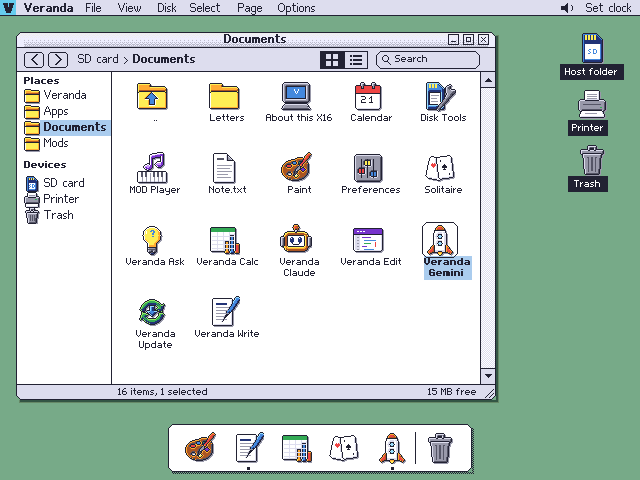
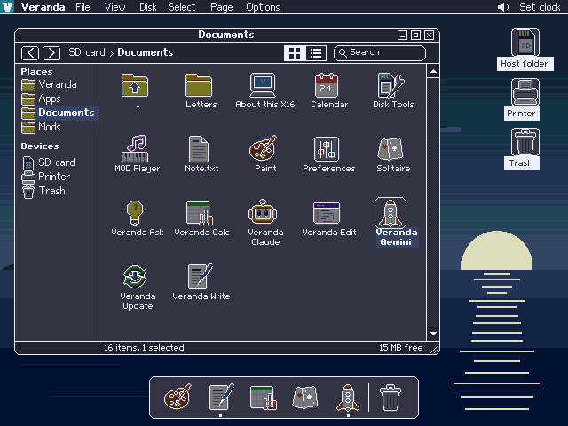
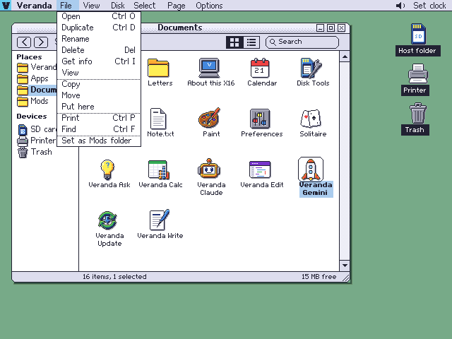
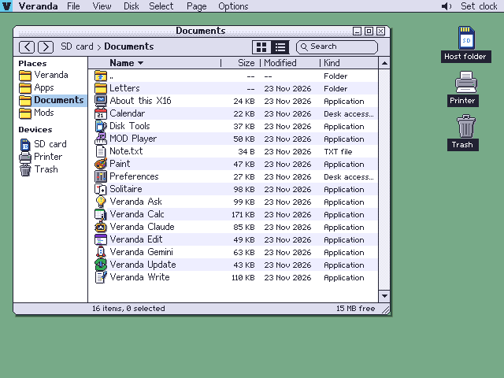
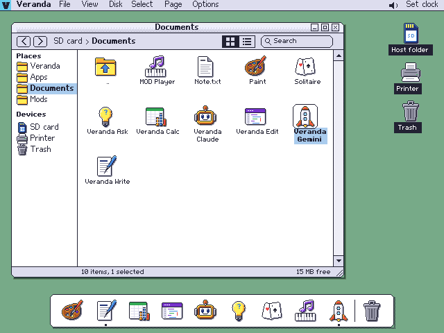

# The desktop

The desktop is the first thing you see. It shows your folders in
windows, starts programs and opens documents. Veranda calls it the
**shell**.

## The parts of the screen

- **The menu bar** at the top: the menus at the left. At the right: the
  speaker and the date and time.
- **Folder windows.** One or two at a time.
- **The desktop icons** at the right: the card, the printer and the
  trash.
- **The dock** at the bottom, when it has something in it: your
  favourite programs (pinned), programs you put aside, and windows you
  minimised.
- **The background** behind it all: the plain colour, a picture or a
  pattern. Veranda comes with four pictures: Dusk, Still Water, Low
  Hills and Sunroom Tiles. Choose one in
  [Preferences, the Desktop page](Preferences.md#the-desktop-page).

## The menu bar

| Menu | Items |
|---|---|
| Veranda | About the shell, Desk accessory (open a desk accessory: see [Desk accessories](Desk-accessories.md)), Help (this manual, see [Help on the X16](Help-on-the-X16.md)) |
| File | Open, Duplicate, Rename, Delete, Get info, View, Copy, Move, Put here, Print, Find, Set as Mods folder |
| View | By icon, By small icon, By name, By size, By date, By type, Refresh, Up a folder |
| Disk | Open the card, New window, Close window, Trash, Empty trash, Documents |
| Select | First, Next, Previous, None |
| Page | Next page, Previous page |
| Options | 640 x 480, 640 x 240, 320 x 240, Preferences..., Pin to the dock, Unpin, BASIC (keep Veranda), Quit Veranda |

The menu bar's right side works in every Veranda program:

- **Click the date and time** to open Preferences at the Date and Time
  rows. If the clock was never set, the bar says **Set clock** instead.
- **Click the speaker** to open a small volume slider with **Mute**.
  Click outside it, or press Esc or Return, to close it.

See [Date, time and time zone](Date-and-time.md) and
[Preferences](Preferences.md).

The desktop's keys (Alt+Tab works everywhere: see below):

| Key | Does |
|---|---|
| Ctrl+O | Open the selected item |
| Ctrl+D | Duplicate it |
| Del or Ctrl+Backspace | Delete it (to the Trash) |
| Ctrl+I | Get info |
| Ctrl+P | Print |
| Ctrl+F | Find |
| Ctrl+R | Refresh the window |
| Ctrl+Up | Up a folder |
| Ctrl+N | A new window |
| Ctrl+W | Close the window |
| Home, Tab, Shift+Tab | Select the first, next or previous item |
| Esc | Select nothing |
| PgDn, PgUp | The next or previous page |
| F1 | Help |
| Ctrl+Q | Quit Veranda |

The menus show these keys at the right of their items.

## A folder window

From the top:

- **The title band** shows the folder's name. At the right are three
  square boxes: **minimise** (the window goes to the dock), **zoom**
  (full size and back) and **close**. Drag the title band to move the
  window.
- **The toolbar**: **back** and **forward**; the **path** (click a
  folder in it to go there); the **icons / list** toggle; the
  **Search** field.
- **The sidebar**: the **places** Veranda, Apps, Documents and Mods,
  and the **devices**: the SD card, the printer and the trash. Click a
  place or the card or the trash to go there. Click the printer to see
  how to print.
- **The contents**: the folder's files and folders.
- **The scroll bar** at the right: the arrows move the contents a row
  up or down; a click on the dotted track above or below the thumb
  moves a page. The thumb shows where you are and how much of the
  folder fits. Drag the thumb to go to a place. With everything in
  view there is no thumb.
- **The status bar**: the number of items, the selection, the free
  space on the card. Drag the corner at the right to resize the
  window.

The **Page** menu (Page Down, Page Up) also moves a page. A mouse
wheel scrolls the front window when the pointer is over it: three rows
a notch in the list, a row of icons a notch in the icons.

### Icons and the list

A folder window opens as a list until you choose otherwise; the
toolbar's two buttons switch between the list and the icons, and the
window keeps your choice. **View > By icon** shows large colour icons.
**By small icon** shows small ones. **By name**, **By size**, **By date** and **By type** show a
list, sorted, with a small icon before each name. In the list, click a
column header (name, size, modified, kind) to sort by it. The sorted
column's header is bold, with a small triangle.

### Opening things

- **Double-click a program** to start it.
- **Double-click a folder** to open it in the same window. The `..` icon
  goes up a folder.
- **Double-click a document** to open it with its program. Veranda finds
  the program by the file's extension, in the folder shown, then in
  `/VERANDA/APPS`, `/VERANDA` and the top folder. Some examples:

| Extension | Opens with |
|---|---|
| `.CWR` | Veranda Write |
| `.TXT` | Veranda Edit |
| `.X16S`, `.XLSX`, `.ODS`, `.CSV` | Veranda Calc |
| `.BMP` | View |
| `.MOD` | MOD Player |
| `.MID`, `.MIDI`, `.ZSM` | MIDI Player |
| `.SID` | SID Player |
| `.SPV`, `.WAV`, `.ZCM` | VIDKIT Player |
| `.D64`, `.D71`, `.D81` | Archive |
| `.TEL` | Term |
| `.BAS` | VeraBASIC |

  A GEOS document (a `.cvt` file, such as a Paint picture) opens with
  the program that made it.
- **Double-click an X16 program** (a `.PRG` file, such as a game for
  the X16's BASIC) to run it. Veranda asks first, goes to BASIC, runs
  the program in its own folder and comes back to the desktop by itself
  when the program ends. See
  [BASIC and back](BASIC-and-back.md#run-a-program-from-the-desktop).
  These files have their own icon: a BASIC screen with a play mark.
- **File > View** opens the selected file in [View](View.md), whatever
  it is.

### Search

Click the **Search** field and type a part of a name. The window shows
the names that hold it. For a search through all folders, use
**File > Find** (see [Files and folders](Files-and-folders.md)).

### Two windows

**Disk > New window** opens a second window. Drag files from one window
to the other to copy them. See [Files and folders](Files-and-folders.md).

## The desktop icons

- **The card** opens the top folder of the SD card.
- **The printer**: drop a BMP picture or a Paint picture on it to
  print it to a PDF file. See [Files and folders](Files-and-folders.md).
- **The trash**: drop files on it to delete them. Double-click it to see
  what is in it.

## The dock and Alt+Tab

**Alt+Tab** puts the program you are using **aside**. The whole program
is kept in RAM, with its document and its screen, and the desktop comes
back. The program now has an icon in the dock with a dot under it.
**Click the icon** and the program comes back exactly where you left
it.

The dock shows:

- the pinned programs, your favourites (one click starts one, or
  brings it back if it is aside);
- the programs that are aside (with a dot);
- the windows you minimised (a folder icon; a click opens the window
  again);
- after a line, **the trash**: click it to see what is in it, or drop
  files on it to delete them.

### Your favourite programs in the dock

The dock keeps up to **10 pinned programs**, in the order you choose.
A new Veranda starts with Veranda Write, Veranda Edit, Paint, Veranda
Gemini, Veranda Ask and Term pinned (those that are in
`/VERANDA/APPS`). Your pins and their order are kept on the card and
come back after a restart.

- **Pin a program:** drag it from a window onto the dock and let go
  where you want it, between two icons. You can also drop it on an
  empty part of the desktop (it goes at the end), or select it and
  choose **Options > Pin to the dock**.
- **Move a pin:** drag its icon along the dock to another place.
- **Unpin:** drag the icon off the dock, or onto the dock's trash. The
  program itself stays where it is; nothing is deleted. **Options >
  Unpin** removes the last pin.
- **One click** on a pinned icon starts the program. If it is aside
  (a dot under it), the click brings it back where you left it.
- **Full:** with 10 pins, Veranda says "The dock is full: unpin a
  program first." When pins, programs aside and minimised windows are
  more than fit, the icons move closer together. At 320 x 240 fewer
  fit.
- **Preferences** has a **Dock** page for the same list: Add..., Remove,
  Move up, Move down, then Save. See [Preferences](Preferences.md).

**Right-click** an icon in the dock for a small menu: **Quit** (a
program that is aside: it is closed and its unsaved work is lost; you
are asked first), **Unpin**, or **Restore** (a minimised window).

Things to know:

- Up to 8 programs can be aside at once.
- On a 512 KB or 1 MB machine Veranda puts a program onto the **SD card**
  when RAM is not enough for it ("Putting ... aside... 120 KB" at the
  top of the screen), in `/VERANDA/.SYSTEM/TASKS`, and reads it back when
  you click its icon ("Bringing back ..."). That takes a few seconds, but
  programs may use nearly all the memory. Preferences' **Video mode,
  switching** row chooses: card (Roomy) or RAM only (Fast, the default
  with 2 MB).
- If the card is full, Veranda says "Not enough room on the card to put
  it aside." and the program goes on. If a program was on the card when
  the power went off, its file is deleted at the next start.
- With RAM only, if there is not enough memory, Veranda says "No memory
  to put it aside." and asks "Quit it, losing its work?". Answer No and
  save your work first.
- A program that has a file open at that moment cannot be put aside
  now. Veranda asks the same question. Try again a moment later.
- Network programs keep their connection while they are aside. The
  modem holds what arrives.

## Desk accessories

Desk accessories are small programs that open **over** the program you
are using: Calculator, Note Pad, Dex, Calendar, Preferences, Photo
Manager and Text Manager. In the desktop, choose **Veranda > Desk
accessory**. In most other programs, the first menu (the program's own
name) has **Desk accessory...**. You can also double-click one in
`/VERANDA/APPS`. See [Desk accessories](Desk-accessories.md).

## Video modes

**Options > 640 x 480** is the normal mode. **640 x 240** and **320 x
240** exist for older GEOS programs. Preferences can set the mode
Veranda starts in. The colour icons show in every mode; a wallpaper
picture shows at 640 x 480 only, and the other modes show the plain
desktop colour instead.

## Other GEOS programs

Veranda uses the classic GEOS programming interface. GEOS programs
whose source code is available can be ported to it, and some have
been. Veranda does **not** run C64 GEOS program files directly. Ports
that are not part of this manual are not described here.

## Leaving the desktop

- **Options > BASIC (keep Veranda)** goes to BASIC and keeps Veranda in
  memory. See [BASIC and back](BASIC-and-back.md).
- **Options > Quit Veranda** leaves Veranda completely.

## If a program crashes

If a program stops with an error, Veranda shows a box with the
program's name, what happened ("It ran into a BRK at $...") and where.
Click **OK**: the desktop comes back. The program's unsaved work is
lost. See [Troubleshooting](Troubleshooting.md).
