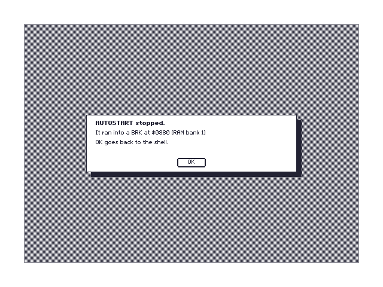

# Troubleshooting and FAQ

## The modem does not answer

What the programs say, and what to check:

| Message | What to check |
|---|---|
| "There is no serial card" (Term), "no network card" | The card is seated in its slot. Its DIP switches put it in one of the ten places from `$9F60` to `$9FF0` (the factory's is `$9FE0`). In Term: Settings, **P** looks for it. |
| "The modem does not answer" | The ESP32 runs Zimodem. Turn the X16 off and on (Zimodem keeps its speed until it is powered off). Try About this X16 > **Ask the modem**. |
| "Could not connect (refused, or no such host)" | The host's name and port. The Wi-Fi: in Term type `ATI2` to see the modem's IP address. For Gemini, Claude, Ask and Update from GitHub: your Zimodem must know `ATCS` (see [Network setup](Network-setup.md#4-tls-does-your-modem-know-atcs)). |
| "No answer in 15 seconds", a server that stops sending for 30 seconds | The network or the server is slow or down. Try again later. |
| "Is claude_bridge.py running on the PC?" | Start the bridge on the PC. Check the PC's address and port 8642, and the PC's firewall. |

## Veranda Ask's sign-in

- **The helper on the PC never hears from the X16:** the PC's address
  and port 8643 are right in Settings; the PC's firewall lets port 8643
  in; the X16 and the PC are on the same home network.
- **The browser does not come back:** port 1455 must be free on the PC.
- **"Set the clock"** in the status bar: set the date, time and time
  zone (see [Date, time and time zone](Date-and-time.md)).
- **"The sign-in has ended: sign in again from your PC":** the sign-in
  was unused for 30 days, or you signed out elsewhere. Run
  `chatgpt_signin.py` again.
- **"The plan did not accept the sign-in (401). Kept.":** run the
  `--check` and look at `ASK.LOG`: see
  [Veranda Ask](Veranda-Ask.md#when-the-plan-refuses---check-and-asklog).
- **"Your ChatGPT plan can't be used in this app":** only Plus and Pro
  plans work. Use an OpenAI API key.

## The clock

- **The menu bar says "Set clock"**: the clock reads 1 January 2000
  (never set). Click it and set it. See
  [Date, time and time zone](Date-and-time.md).
- **The clock forgets the time** when the X16 is off: the X16's clock
  battery may be empty.
- **The time is one hour off** after a change to or from summer time:
  Veranda does not change it by itself. Change the clock and the time
  zone by hand.

## A program does not start

- **"Cannot start it:"** with a reason. Often the reason is memory (RAM
  banks). Veranda runs on 512 KB, but programs put aside with Alt+Tab
  keep their memory. **Right-click** them in the dock and choose
  **Quit**, then try again. [About this X16](About-this-X16.md) shows
  which programs hold how many banks.
- **"No application opens this file."**: no program in the folder,
  `/VERANDA/APPS`, `/VERANDA` or the top folder takes that extension. Use
  **File > View** to look at it.
- **"No memory to put it aside." / "Quit it, losing its work?"** after
  Alt+Tab: there is not enough memory to keep the program. Answer No,
  save your work, and quit other programs that are aside.
- **A program is missing**: check `/VERANDA/APPS`. Some programs (SID
  Player, Lighthouse Pinball, Harbour Walls) are not in every package.
- On a 2 MB machine, programs have more room for documents.

## The crash box

If a program stops with an error, Veranda shows a box:

- "The program **name** stopped."
- why: "It ran into a BRK at $xxxx", "It called Panic at $xxxx" or "Its
  stack was full at $xxxx", and the RAM bank.

Click **OK**. The desktop comes back with Veranda's kernel restored from
its copy in RAM. The program's unsaved work is lost.

**Photograph the box** before you click OK: the name, the reason and the
address help to find the bug.

## Where the logs are

| File | What is in it |
|---|---|
| `/VERANDA/.SYSTEM/ASK.LOG` | Veranda Ask's last renewal and last request (no tokens) |
| `/VERANDA/.SYSTEM/LAYOUT.LOG` | what Veranda Setup moved where |
| `/VERANDA/UPDATE.LST` | the build installed (its first lines) |
| About this X16 > **Copy** | the machine's facts on the clipboard |

## Undo an update

In [Veranda Update](Veranda-Update.md) choose **Undo last update**. It
puts back the files the last update replaced, from
`/VERANDA/.SYSTEM/OLD/<build>/`, and removes the files it added. Only the
last update can be undone.

If Veranda does not start any more after an update: put the card in a
PC and copy the files from `/VERANDA/.SYSTEM/OLD/<build>/` back to their
places (the file `UNDO.LST` in that folder lists where each one
belongs), or copy a whole package's `VERANDA` folder over the card's.

## How to report a bug

Please give:

1. **What you did**, step by step, and what you expected.
2. **A photo of the screen** when it goes wrong (the whole screen, sharp
   enough to read). For a crash: the crash box.
3. **About this X16**: click **Copy**, paste into [Veranda
   Edit](Veranda-Edit.md) or [Note Pad](Note-Pad.md), save, and send the
   text (or a photo of the About window). It has Veranda's build, the
   ROM, the memory and the card.
4. For network problems: the program's message, and for Veranda Ask
   `ASK.LOG`.

Report it on Veranda's public repository on GitHub.

## FAQ

**Can Veranda run my C64 GEOS programs?** No. Veranda uses GEOS's
programming interface, so GEOS programs with source code can be ported,
but it does not run C64 program files. [Archive](Archive.md) can copy
documents out of C64 GEOS disk images.

**Do I need 2 MB?** No. Veranda runs on a stock 512 KB X16. 2 MB gives
more room for documents and for programs put aside.

**Where are my files?** In `/DOCUMENTS`. **Disk > Documents** opens it.

**The screen went dark.** The screen blanker: move the mouse or press a
key. Preferences sets the delay.

**How do I get back to BASIC?** **Options > BASIC (keep Veranda)**; come
back with `SYS 35328`. See [BASIC and back](BASIC-and-back.md).

**Does Veranda print?** To PDF files. See
[Files and folders](Files-and-folders.md#print-to-pdf).

**Is it safe to type passwords?** They are stored as plain text on the
card, and the modem does not check certificates. See
[Network setup](Network-setup.md#security-what-you-must-know).
