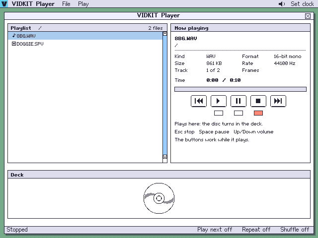

# VIDKIT Player

VIDKIT Player plays **SPV videos** full screen and **WAV and ZCM audio**
in its window. It streams them from the SD card with **VIDKIT**, Anthony
W. Henry's banked-RAM streaming library, which is packed inside the
program. Its window follows [MOD Player](MOD-Player.md)'s. Version 1.0,
by Anthony W. Henry, written in Prog8. MIT licence.

It needs the X16 ROM R48 or later. It is in `/VERANDA/APPS` as
`VIDKIT Player.cvt`.

## Start it

- Double-click a `.SPV`, `.WAV` or `.ZCM` file: VIDKIT Player opens
  with that file's folder as the playlist. Choose the file there and
  press Return (or double-click it).
- Or double-click **VIDKIT Player** in `/VERANDA/APPS` and go to your
  files in its playlist.

## The window

- **The playlist**: the folder's folders, then its SPV, WAV and ZCM
  files, `..` to go up. Double-click a file to play it, a folder to open
  it. The one playing is marked.
- **Now playing**: the file chosen: its kind, format, size, rate, track
  (1 of 2 ...), frames, the time and its length, and its bookmark if it
  has one; a progress bar; the buttons previous, play, pause, stop,
  next, with their lights.
- **The deck**: an audio CD whose sheen turns while audio plays.
- The status bar: Stopped, Playing, Finished and so on on the left;
  Play next, Repeat and Shuffle on the right.

**A video** takes the whole screen: the window fades to black first,
and fades back in when the video ends. **Audio** plays in the window;
the buttons work with the mouse while it plays.

## Menus

| Menu | Items |
|---|---|
| VIDKIT Player | About VIDKIT Player |
| File | Play all (the folder from its first file), Quit |
| Play | Play, Stop, Next, Previous, Repeat: off/on, Shuffle: off/on, Play next: off/on |

## Keys

In the playlist:

| Key | Action |
|---|---|
| Up, Down | move the selection |
| PgUp, PgDn | move the selection 15 rows |
| Home, End | the first, the last entry |
| Return | open the folder, or play the file |
| Space | play the file chosen |
| Right | play the next file |
| Left | play the previous file |
| Backspace | up a folder |
| Alt+Q | quit |

While a file plays:

| Key | Action |
|---|---|
| Esc | stop |
| Space | pause, and go on |
| Up, Down | the volume |
| F5 | play the file again when it ends (Esc still stops it) |

The mouse: the playlist (double-click), the scroll bar, the buttons,
the close box.

## Play next, Repeat, Shuffle

- **Play next** (off at first): when a file ends, the next one plays by
  itself. A video followed by another video runs straight into it,
  fading through black, without coming back to the window.
- **Repeat**: the same file plays again when it ends.
- **Shuffle**: Next picks a file at random (never the one that just
  played).
- Next and Previous wrap at the ends of the list.
- While a run of files plays (Play next, Repeat, Play all), the screen
  does not blank, even with no key pressed. The screen blanking you set
  in [Preferences](Preferences.md) comes back when the run ends.

## Bookmarks

Stop a file part way, and VIDKIT Player leaves a **bookmark** beside it
in the same folder: `NAME.MARK` for `NAME.SPV`, `NAME.WAV` or
`NAME.ZCM`. It holds where the file stopped (the video's frame, the
audio's position). VIDKIT's own stand-alone players write the same
files, so each resumes the other's bookmarks.

- Choose a bookmarked file, and VIDKIT Player asks **Resume where it
  stopped?**: **Yes** goes on from the bookmark, **No** starts again
  from the beginning and deletes the bookmark, **Cancel** plays nothing.
- Play next, Repeat and Play all use the bookmark without asking.
- A file that plays to its end loses its bookmark.

## Notes and limits

- **High-bandwidth SPV videos play from the SD card only**, not from a
  folder on a PC (the emulator's host file system). VIDKIT Player says
  "High bandwidth video: SD card only".
- "VIDKIT cannot play it": VIDKIT could not open or play the file.
- "VIDKIT needs ROM R48 or later": update the X16's ROM.
- Up to 255 entries in the playlist. A file name of 62 characters or
  more is listed but cannot be played.
- While a file plays, VIDKIT has the machine: the menus and desk
  accessories wait until it stops (the buttons work for audio).
- It needs enough RAM banks for VIDKIT; without them it says "Not
  enough RAM banks."

## Credits

VIDKIT Player and VIDKIT are by **Anthony W. Henry**, MIT licence. The
player is built with [Prog8](https://github.com/irmen/prog8) and Prog8
for Veranda ([For developers](For-developers.md#programs-in-prog8)).
The parts of its window ported from MOD Player keep their notice
(Marcin Spoczynski, MIT). See [Licences](Licences.md).
