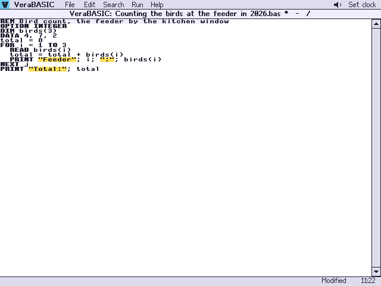
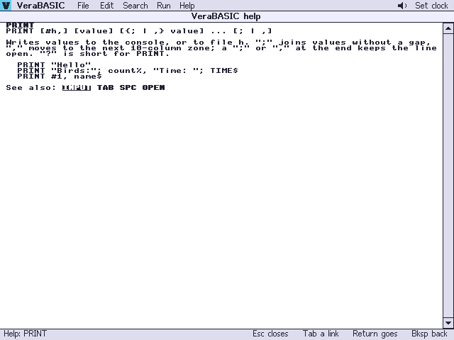

# VeraBASIC

VeraBASIC is a **BASIC for Veranda**: a structured BASIC with Veranda's
windows, menus, dialog boxes, graphics, files with long names, sound and
the switcher. Programs are plain `.bas` text files.

VeraBASIC has **its own full manual**:
[the VeraBASIC manual](../vbasic/manual/README.md) (a tutorial, the
editor, the language, the reference). This page only tells you how to
start.

## The two programs

- **VeraBASIC** is the editor and the runtime in one: write a program,
  check it, run it. It colours the program, shows the syntax of the
  keyword at the cursor, and jumps to an error's line.
- **VeraBASIC Run** runs finished programs.

## Start it

- Double-click a `.bas` file: VeraBASIC opens it.
- Or double-click **VeraBASIC** in `/VERANDA/APPS`.

## The most important keys

| Key | Action |
|---|---|
| Ctrl+K | Check the program |
| F8 | the next error |
| Ctrl+R | Run |
| Ctrl+C | Stop a running program |
| F1 | help on the keyword at the cursor (on other words: the contents) |
| Ctrl+N, Ctrl+O, Ctrl+S, Ctrl+Q | New, Open, Save, Quit |

All keys are in the manual's chapter [The editor](../vbasic/manual/editor.md).

## Help on the X16

**F1** opens VeraBASIC's help viewer. The help files are in
`/VERANDA/HELP`: the keywords, the errors, the tutorial, the editor and
the manual's chapters. **Help > Contents > Manual** in the editor opens
the manual. `Reference card.pdf` in the same folder is a two-page
reference card to print on a PC.

In the help viewer: Up, Down, PgUp, PgDn and its scroll bar scroll; Tab and Shift+Tab
choose a link; Return (or a click) follows it; Backspace goes back; Esc
closes.

## Examples and applications

- `/DOCUMENTS/VeraBASIC Examples` has example programs (Notes, Dice,
  Address book, Tiles) and the tutorial's seven steps to *Bird Watch*.
- **File > Make application...** turns a program into an application of
  its own, with its own icon. **Bird Watch** in `/VERANDA/APPS` is one
  (it opens `Garden.brd` in `/DOCUMENTS`).

## Files

While saving, VeraBASIC writes `~VBASIC.TMP` first. If a save is cut
short, [Disk Tools](Disk-Tools.md) can find this file.
