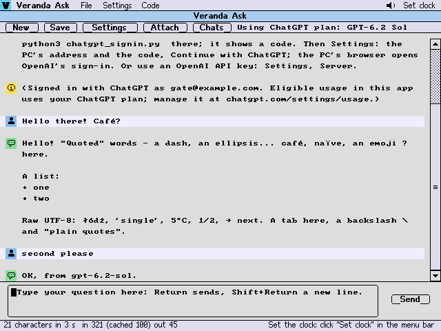
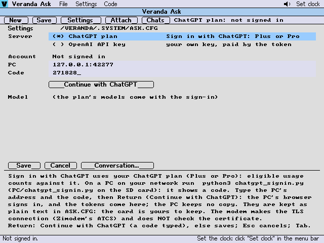
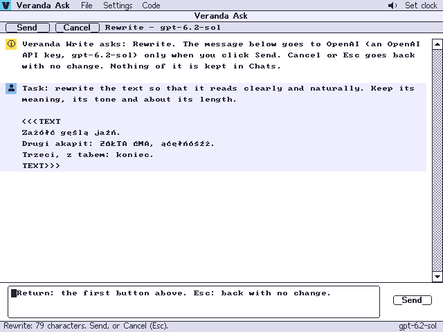
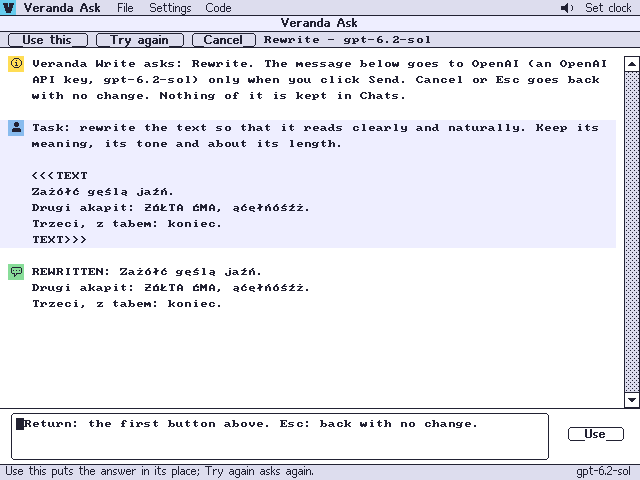

# Veranda Ask

Veranda Ask is a conversation with **OpenAI's models** on the X16. It
uses **your ChatGPT plan** (ChatGPT Plus or Pro, through "Sign in with
ChatGPT") or **an OpenAI API key**. It is Veranda Claude's sibling: the
same window, keys, code blocks, attached files, chats and cost controls.
Read [Veranda Claude](Veranda-Claude.md) for those; this page covers
what is different.

It needs the Wi-Fi modem with Zimodem's `ATCS` (see
[Network setup](Network-setup.md)) and a **set clock** (see
[Date, time and time zone](Date-and-time.md)).

## Sign in with ChatGPT (your plan)

The X16 has no web browser. So you sign in on a **PC** on your home
network, and the PC hands the sign-in to the X16. The PC keeps no copy.

1. Copy `PC/chatgpt_signin.py` from the card to a PC with a web browser
   and Python 3. Run it:

       python3 chatgpt_signin.py

   It prints a **6-digit code** and the PC's address (port 8643).
2. In Veranda Ask: **Settings**, Server **ChatGPT plan**. Type the PC's
   address (for example `192.168.1.20:8643`), **Tab**, the code, then
   **Return** (or click **Continue with ChatGPT**). The status bar says
   "Signing in: finish in the browser on your PC".
3. On the PC the browser opens OpenAI's sign-in page. Sign in and allow
   Veranda Ask. The X16 says "Signed in". The first time it shows the
   plan's notice: click **Got it**. The helper on the PC stops.

**Or, with the X16's card in the PC:**

    python3 chatgpt_signin.py --card /path/to/the/card/VERANDA

writes the sign-in onto the card directly.

Notes:

- The code works for one sign-in. Five wrong codes stop the helper.
- Port 8643 on the PC must be open to the X16, and port 1455 must be
  free on the PC (for the browser's way back).
- During the sign-in the code and the credentials cross your home
  network as plain HTTP. Only home-network addresses may connect.
- **Esc** on the X16 cancels a sign-in.

### While you use the plan

- The toolbar says "Using ChatGPT plan: <model>". The models are your
  plan's own list (up to 8); choose one in Settings.
- The status bar shows tokens only, no money. "Manage usage:
  chatgpt.com/settings/usage" (the X16 cannot open links).
- Usage counts against your ChatGPT plan's limits. When a limit is
  reached, Veranda Ask says "Usage limit reached ..." (no reset time is
  given).
- A plan other than Plus or Pro cannot be used: "Your ChatGPT plan can't
  be used in this app". Use an API key instead.

### Renewal

A sign-in token lasts an hour. Veranda Ask renews it by itself, and
saves the new tokens before it uses them. It needs a **set clock**
(2026 or later) and the right **time zone** to know when a token
expires. With an unset clock, the status bar says "Set the clock".

After 30 days without use, or when you sign out elsewhere, the sign-in
ends: "The sign-in has ended: sign in again from your PC".

## When the plan refuses: --check and ASK.LOG

If the plan refuses you ("The plan did not accept the sign-in (401).
Kept."):

1. Put the card in the PC and run (with your card's path in `C`):

       C=/path/to/the/card
       python3 $C/PC/chatgpt_signin.py --card $C/VERANDA --check

   It signs in, then sends from the PC exactly the X16's own request
   ("Reply with OK") and a renewal, and says what happened, with
   OpenAI's error message. It never prints a token.
   - "PC call OK": OpenAI takes the request; the X16's sending is the
     suspect. Report it with ASK.LOG.
   - "PC call 401": shows OpenAI's reason.
2. Look at **ASK.LOG** (`/VERANDA/.SYSTEM/ASK.LOG`, at most 2.5 KB). It
   is written after every request: the last renewal and the last turn,
   the status, the important headers, an error's text, the X16's clock.
   **It never holds a token or a cookie**, so you can photograph it or
   copy it to a PC for a bug report.

## An OpenAI API key instead

**Settings**, Server **OpenAI API key**: type or paste (Ctrl+V) the key
(from platform.openai.com; paid by use), **Tab**, the model's name
(`gpt-6.2-sol` at first). Or write a line `key=sk-...` in
`/VERANDA/.SYSTEM/ASK.CFG` from a PC. With a key the status bar shows
tokens only (OpenAI's prices are not in the program).

## Your tokens on the card

The sign-in (the tokens) and the API key are kept **as plain text** in
`/VERANDA/.SYSTEM/ASK.CFG`. The card has no file permissions: **anyone
with your card can use your plan** until the tokens expire or you sign
in again. Keep the card to yourself. To remove them: delete the
`access=` and `refresh=` lines, or the whole file.

## Help with another program's text

Another program can ask Veranda Ask to work on a piece of its text:
**rewrite** it, **shorten** it, **fix its grammar and spelling**,
**translate** it into English or Polish, **summarise** it, or **answer
a question** about it. [Veranda Write](Veranda-Write.md) offers this
in its **AI** menu, on the text you select (see its "AI help"). It
uses your sign-in or API key from Veranda Ask: there is nothing else to
set up, and the other program never sees them.

When a program asks, it goes aside and Veranda Ask starts with the
request on the screen:

- The toolbar: **Send**, **Cancel**, and what is asked, with the model
  ("Rewrite - GPT-6.2 Sol").
- A note says who asks and what, and that the message goes to OpenAI
  **only when you click Send**.
- Below it, the message exactly as it will be sent: the task and the
  text.

**Send** (or Return) sends it. **Cancel** (or Esc) goes back to the
program with no change; nothing has left the X16.

The answer appears as it comes. Read it, then:

- **Use this** (Return): the program gets the answer and comes back.
- **Try again** (T): the same request again; the new answer replaces the
  old one.
- **Cancel**: back to the program with no change.

Good to know:

- Up to **8,192 characters** of text at a time. Select less if the
  program says it is too long.
- Polish letters go both ways.
- A request is not kept in Chats, and nothing else of your conversation
  goes with it. Your own system prompt and "short answers" do not apply
  to it.
- If Veranda Ask is not signed in (and has no API key), it says "Sign in
  in Veranda Ask first" and goes back; the program tells you so. Start
  Veranda Ask and sign in (above), then ask again. An access token that
  has expired is renewed by itself, as for any message.
- If the network card cannot be used, Veranda Ask says why and goes
  back: "No network card was found.", "The modem does not answer.", or
  "Not enough memory for the network card": a program put aside holds
  the memory. Quit one (Alt+Tab, then its Quit), or choose **Roomy**
  switching in Preferences, and ask again.
- The answer is the model's: read it before you click Use this.

## Differences from Veranda Claude

- Chats are kept in `/DOCUMENTS/Chats/Ask`.
- An attached file can be up to 8 KB (the conversation keeps 24 KB).
- **Compact** uses the plan's cheapest model (one named "nano", else
  "mini"); with an API key, the one model you typed.
- The Settings menu has Sign-in, key and model...; Conversation...,
  Compact conversation (the models are chosen on the Settings page).
