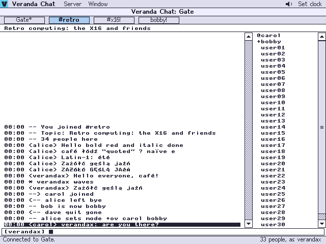
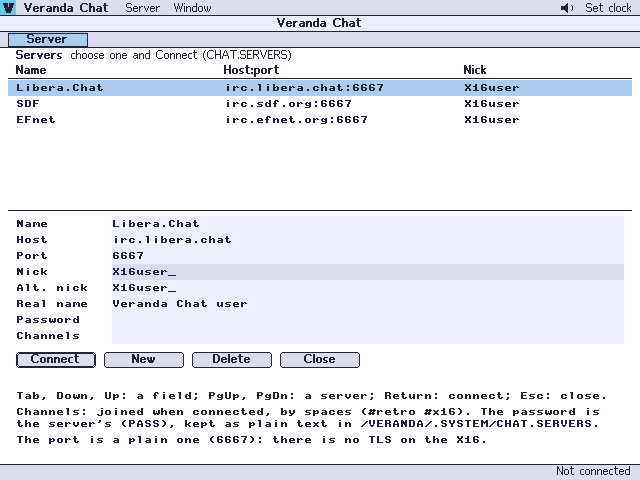

# Veranda Chat

Veranda Chat is an **IRC** client. IRC (Internet Relay Chat) is chat in
channels (`#name`) and private conversations, on one server at a time.
It works through the Wi-Fi modem (see [Network setup](Network-setup.md)).

## Connect

**Server > Servers...** (shown at the start) lists your servers. The
selected one's fields: name, host, port, nick, an alternative nick (used
when your nick is taken), real name, password (the server's: for a
bouncer, or a registered nick where the server takes it so) and the
channels to join, such as `#retro #x16`.

- Tab, Down and Up move between the fields. PgUp and PgDn choose a
  server.
- **Connect** (or Return, or a double-click) connects. It is the
  default button: its frame is thicker.
- **New** and **Delete** add and remove a server. Esc closes the page.

The first time, the list has Libera.Chat, SDF and EFnet.

## The window

- **The tabs** at the top: the server's window, then up to six channels
  and private conversations. Click one, or press **F1-F7**, **Ctrl+N**
  (next), **Ctrl+P** (previous). `*` after a name: new lines. `!`: a
  line that names you, or a new private message. A name in brackets is
  a channel you are no longer in.
- **The topic** under the tabs.
- **The text**, with the time of each line (Window > Times on/off). A
  line that names you is shown reversed, with a sound. Its scroll bar
  is at its right: an arrow scrolls a row, a click on the track a page.
- **The nick list** at the right of a channel: operators (`@`), voices
  (`+`), then the others. Click a nick to put it in the input line. It
  has its own scroll bar. Window > Nick list on/off.
- **The input line** at the bottom, in a frame.
- **The status bar**: what happened at the left; the connection and
  the people in the channel at the right.

## Menus

| Menu | Items |
|---|---|
| Veranda Chat | About Veranda Chat; Quit (Ctrl+Q) |
| Server | Servers...; Disconnect |
| Window | Next (Ctrl+N), Previous (Ctrl+P), Close (Ctrl+W); Nick list on/off, Times on/off; Clear |

The menus show their keys at the right.

## Keys

| Key | Action |
|---|---|
| Return | send the line |
| Left, Right, Home, End, Backspace, Delete | edit the line |
| Up, Down | the last 8 lines you sent |
| Tab | complete a nick of the channel (again: the next one) |
| Ctrl+V | paste the clipboard's first line |
| PgUp, PgDn, wheel, the scroll bar | scroll back |
| End, Esc | back to the newest lines |
| F1-F7, Ctrl+N, Ctrl+P | change tab |
| Ctrl+W | close the tab |
| Ctrl+Q | quit (asks first when you are connected) |

## Commands

| Command | Does |
|---|---|
| `/join #channel [key]` | join a channel |
| `/part [reason]` | leave the channel |
| `/msg nick text` | a private message |
| `/query nick [text]` | open a tab for a private conversation |
| `/me action` | an action (`* nick action`) |
| `/nick new` | change your nick |
| `/topic [text]` | show or set the topic |
| `/notice nick text` | a notice |
| `/raw line` (or `/quote`) | send a line to the server as it is |
| `/close` | leave a channel or close a conversation |
| `/clear` | clear the window |
| `/quit [reason]` | disconnect |
| `/help` | the commands |

Other commands are sent as they are (`/whois nick`, `/away` ...).
`//text` sends a line that starts with `/`.

## Characters

IRC's bold and colours are taken out. UTF-8 is decoded: Latin-1 letters
(é, ü, ñ) are shown; other European letters as their base letter (ł as
l); other scripts as `?`. What you type is sent as UTF-8.

## Saved servers: CHAT.SERVERS

`/VERANDA/.SYSTEM/CHAT.SERVERS`, one server per line:

    name,host,port,nick,alternative nick,real name,password,channels

Up to 8 servers. **The password is kept as plain text.**

## Limits

- Port 6667, no TLS: servers that need TLS or SASL cannot be used. No
  DCC.
- One server; the server's window and 6 channels or conversations.
- Each window keeps about 50 lines (4 KB). A channel lists 190 people
  at most; the list's last row says how many more there are ("and 2209
  more"), and the status bar counts everyone.
- Pasting many lines fast may get you disconnected for flooding.

**Alt+Tab** keeps the connection: what arrives meanwhile comes in when
you come back. If you are away long, the server may drop you.
