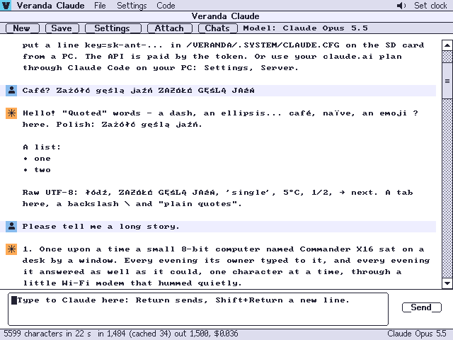
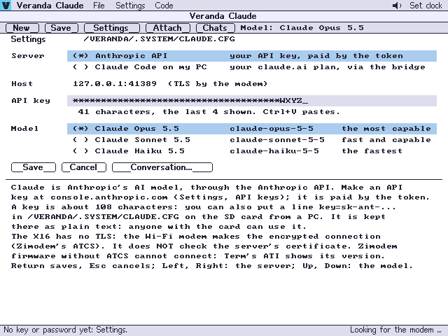
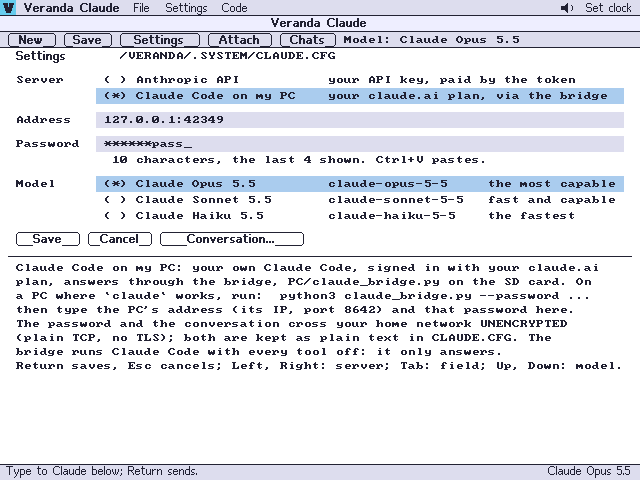
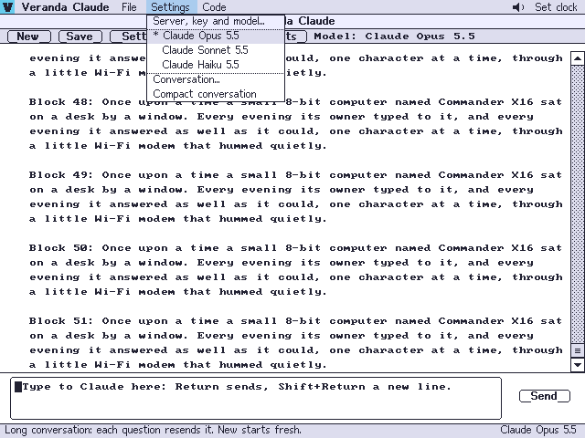
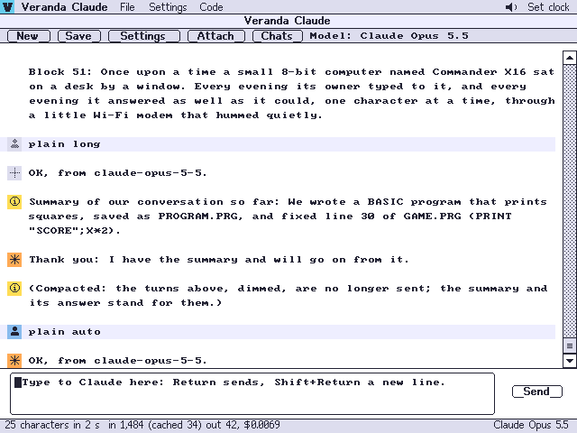
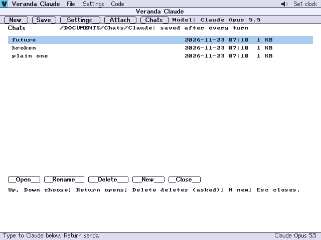

# Veranda Claude

Veranda Claude is a conversation with **Claude**, Anthropic's AI model,
on the X16. You type a question; Claude's answer appears as it is
written. It can save code from the answers as files, even as BASIC
programs the X16 can run.

It works in two ways:

1. **With an Anthropic API key** (paid by use), through the Wi-Fi modem.
   This needs Zimodem with `ATCS` (see [Network setup](Network-setup.md)).
2. **With your claude.ai plan**, through **Claude Code on your PC** and
   a small bridge program. The X16 is then only the screen and the
   keyboard.

## Way 1: an API key

1. Make a key at **console.anthropic.com** (Settings, API keys).
2. Start Veranda Claude. The first time, it opens **Settings**.
3. Server: **Anthropic API**. Type the key (shown as stars), or paste it
   with Ctrl+V. Press Return.

Easier: write the key on the card from a PC, as a line in
`/VERANDA/.SYSTEM/CLAUDE.CFG`:

    key=sk-ant-api03-...

**The key is kept there as plain text.** Anyone with your card can use
it and spend your money.

## Way 2: Claude Code on your PC (a claude.ai plan)

A claude.ai subscription is for Anthropic's own apps, such as Claude
Code. So Veranda Claude talks to **your own Claude Code** on a PC.

1. On a PC where Claude Code (`claude`) is installed and signed in, with
   Python 3, copy `PC/claude_bridge.py` from the card and run:

       python3 claude_bridge.py --password something-long

   It listens on port 8642 and prints the PC's address.
2. In Veranda Claude: **Settings**, Server **Claude Code on my PC**, the
   PC's address (for example `192.168.1.20:8642`), **Tab**, the same
   password, **Return**.

The status bar then says "on my PC". Claude Code runs with **every tool
off**: the X16 cannot make the PC run a command or read a file. The
connection is **plain TCP**: the password and the conversation cross
your home network unencrypted, and the password is kept as plain text in
`CLAUDE.CFG`.

`python3 claude_bridge.py --help` lists its options.

## Talk

- Type in the box at the bottom and press **Return** (or click
  **Send**). **Shift+Return** starts a new line. Left, Right, Home, End,
  Backspace, Delete edit; Up and Down move between the box's lines;
  Ctrl+V pastes.
- Claude **thinks first**: "Thinking ..." with the seconds. Then the
  text comes. **Esc** (or **Stop**) stops it; what came is kept.
- **PgUp**, **PgDn**, the wheel and the scroll bar at the right scroll:
  an arrow scrolls a row, a click on the track a page, and the thumb
  can be dragged. Esc goes back to the newest.
- **Settings > model**: **Claude Opus 5.5** (the default, the most
  capable), **Claude Sonnet 5.5**, **Claude Haiku 5.5** (the fastest
  and cheapest).
- **File > New conversation** (Ctrl+N) starts again.
- **File > Export as text...** (Ctrl+S) writes the conversation to
  `/DOCUMENTS` as a text file.
- **Alt+Tab** works while an answer comes.
- **Quit** (Ctrl+Q) is in the Veranda Claude menu and the File menu.

## Menus

The menus group their items with dotted lines and show the keys at the
right.

| Menu | Items |
|---|---|
| Veranda Claude | About Veranda Claude; Quit (Ctrl+Q) |
| File | New conversation (Ctrl+N), Chats... (Ctrl+L); Export as text... (Ctrl+S); Quit (Ctrl+Q) |
| Settings | Server, key and model...; Claude Opus 5.5, Claude Sonnet 5.5, Claude Haiku 5.5 (the one in use marked `*`); Conversation..., Compact conversation |
| Code | Copy last code block (Ctrl+K), Save last code block... (Ctrl+E), Go to code block...; Copy last reply; Attach a file... (Ctrl+Shift+A) |

## Code in answers

Code in an answer is shaded. Its first row shows the language and
buttons:

- **[Copy]** puts the code on the clipboard (for Veranda Edit,
  Veranda Write ...).
- **[Save...]** saves it to `/DOCUMENTS` as a text file (`PROGRAM.BAS`,
  `CODE.C` ...; long names are fine).
- **[Save .PRG]** (BASIC only) saves a program the X16's own BASIC can
  `LOAD` and `RUN`. Line numbers must go up.

The **Code** menu: Copy last code block (**Ctrl+K**), Save last code
block... (**Ctrl+E**), Go to code block..., Copy last reply, Attach a
file... (**Ctrl+Shift+A**).

### Attach a file

**Attach** (the toolbar) sends a file from `/DOCUMENTS` with your next
question: plain text, a Veranda Write `.cwr` (its text only), or a
BASIC `.PRG` (made into text). Up to 12 KB. The answer's new version of
the file can be saved back over it with [Save...]. For example: attach
`GAME.PRG`, ask Claude to fix line 30, save over the file, run it.

To run a saved BASIC program: quit to BASIC (see
[BASIC and back](BASIC-and-back.md)) and type `LOAD"/DOCUMENTS/GAME.PRG"`
and `RUN`.

## Chats

Every conversation is saved after each turn in `/DOCUMENTS/Chats/Claude`
(one `.chat` file per chat). **File > Chats...** (Ctrl+L) lists the 16
newest: **Open** (go on with it), **Rename**, **Delete**, **New**. No
key or password is ever written into a chat file.

## What a question costs

The API remembers nothing between questions: **each question sends the
whole conversation again**. A long conversation costs more each time.
The status bar shows each turn's tokens ("in 1,484 (cached 34) out
42"), and with an API key an estimate in dollars (only an estimate: the
bill is Anthropic's).

To keep it small (**Settings > Conversation...**):

- **Remember**: everything, the last 10 messages, the last 4, or only
  the question.
- **Old code shortened** (on at first): old code blocks are sent as one
  line.
- **Compact**: Claude Haiku summarises the conversation in 150 words;
  the summary stands for the old turns (they stay on the screen,
  dimmed). **Settings > Compact conversation**, or automatic when a
  question would send more than 6 KB.
- **Short answers**: shorter replies.
- **Ctrl+Return** sends one question to the cheapest model.
- **File > New conversation** starts fresh (the old one stays in Chats).

## Errors

- A wrong key (401) or a busy API (429, 529): a box, and your text goes
  back into the input box. Return sends it again.
- An answer Claude declines is marked and left out; rephrase it.
- "Is claude_bridge.py running on the PC?": start the bridge.
- "Could not connect to api.anthropic.com": check `ATCS` (see
  [Network setup](Network-setup.md)).

## Limits

- The conversation in memory is 32 KB. When it is full, the oldest
  turns are dropped (a note says so). The chat file keeps everything.
- Answers come at about 2 to 3 KB a second.
- The modem does not check the server's certificate.
