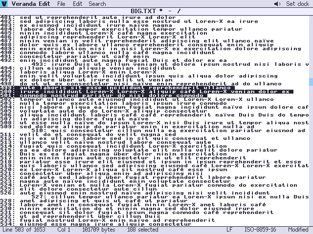
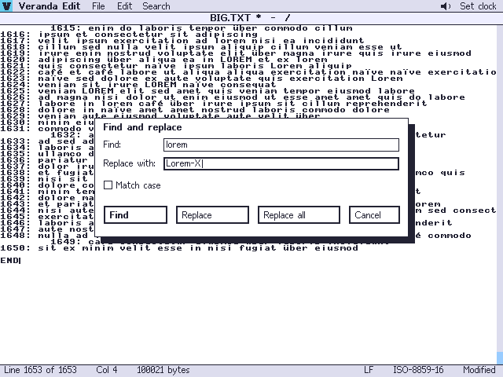

# Veranda Edit

Veranda Edit is a **plain text editor**. Use it for text files: notes,
lists, BASIC listings, configuration files, README files. It keeps a
file exactly as it is: no fonts, no styles. For letters and documents
with styles, use [Veranda Write](Veranda-Write.md).

## Start it

- Double-click **Veranda Edit** in `/VERANDA/APPS`.
- Double-click a `.TXT` file: Veranda Edit opens it.

## The window

The menu bar; a title bar with the file's name and folder; the text in
79 columns and 54 lines; a scroll bar; and a status bar: at its left the
line, the column, the size and the selection, at its right the kind of
line ends, the encoding and "Modified" (or a short message, until the
next key). The menus show each command's key at the right.

## Features

- Plain text in Veranda's character set (ISO-8859-16) or in UTF-8. A
  UTF-8 file whose characters are all in the set is shown with them and
  saved as UTF-8 again; **File > Encoding** (Ctrl+E) switches how the
  text is saved. Any other file is kept byte by byte.
- Line ends **LF**, **CR LF** or **CR**: the file keeps the kind it had.
- Files up to about **330 KB** on a 512 KB X16. The text is kept in RAM
  banks.
- Select with the keys (Shift and a move) or with the mouse (drag).
- Undo.
- Find and replace, find next, go to line.
- Cut, copy and paste through Veranda's clipboard, so text moves to and
  from other programs.

## Menus

| Menu | Items |
|---|---|
| Veranda Edit | About Veranda Edit, Desk accessory... |
| File | New, Open..., Save, Save as..., Encoding, Quit |
| Edit | Undo, Cut, Copy, Paste, Select all |
| Search | Find and replace..., Find next, Replace, find next, Go to line... |

## Keys

| Key | Action |
|---|---|
| Arrows | move; with **Shift**: select |
| Ctrl+Left, Ctrl+Right | a word left, right |
| Home, End | start, end of the line |
| Shift+Home | select to the start of the line |
| PgUp, PgDn | a page up, down |
| Ctrl+PgUp (or Ctrl+Home), Ctrl+End | start, end of the file |
| Backspace, Delete | delete left, right (or the selection) |
| Return | a new line |
| Tab | a tab character |
| Esc | remove the selection |
| Ctrl+N, Ctrl+O, Ctrl+S | New, Open, Save |
| Ctrl+Shift+S | Save as |
| Ctrl+E | the encoding the text is saved in |
| Ctrl+Q | Quit |
| Ctrl+Z | Undo |
| Ctrl+X, Ctrl+C, Ctrl+V, Ctrl+A | Cut, Copy, Paste, Select all |
| Ctrl+F | Find and replace |
| F3 | Find next |
| Ctrl+R | Replace, then find the next |
| Ctrl+L (or Ctrl+G) | Go to line |
| Alt + the same letters | the same as Ctrl |

## Files

- Open and Save use Veranda's standard box (see
  [Files and folders](Files-and-folders.md)). The first Open and Save
  go to `/DOCUMENTS`.
- While saving, Veranda Edit writes `~VEDIT.TMP` first. If a save is
  cut short (for example the power goes off), this file may be left on
  the card. It may hold your text: open it in Veranda Edit before you
  delete it. [Disk Tools](Disk-Tools.md) can find and delete such files.

## Limits

- About 330 KB of text on a 512 KB machine.
- One file at a time.
- No redo.
