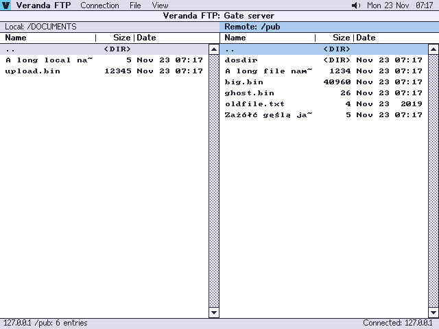
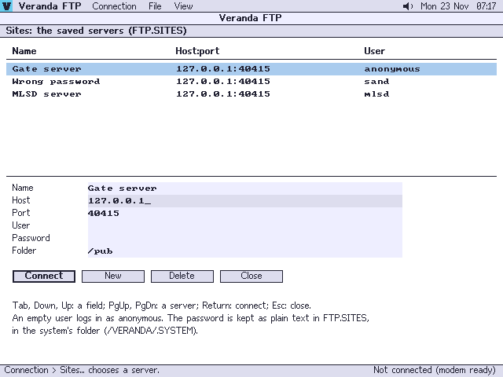

# Veranda FTP

Veranda FTP copies files between the SD card and an **FTP server**,
through the Wi-Fi modem (see [Network setup](Network-setup.md)).

## The window

Two panes side by side: **the card** on the left (it starts in
`/DOCUMENTS`), **the server** on the right. Each shows its folder above
its columns, names, sizes and dates, and has a scroll bar: click an
arrow to move a line, the track to move a page. The pane you work in has
its folder in bold, on the highlight colour. The status bar shows what
is happening; during a transfer, the bytes, the percentage, a progress
bar and the speed.

## Connect

1. **Connection > Sites...** shows your saved servers.
2. **New** adds a server. Click a field (or Tab, Down, Up) and type:
   name, host, port, user, password, start folder. Leave the user empty
   to log in as `anonymous`.
3. Click a server, then **Connect** (or double-click it, or press
   Return). **Delete** forgets the selected server. **Close** (or Esc)
   goes back to the panes.

**Connection > Connect** connects to the selected server again.
**Connection > Disconnect** says goodbye.

## Work with files

- **Double-click a folder** to open it. `..` goes up. This works in both
  panes.
- **File > Download** copies the selected file on the server into the
  card's folder.
- **File > Upload** copies the selected file on the card into the
  server's folder.
- **New folder...**, **Delete** and **Rename...** work on the pane you
  last clicked in. **Refresh** reads the pane again.
- **View** sorts both panes by name, size or date; **Other pane**
  switches pane.

The menus show their keys at the right.

| Key | Action |
|---|---|
| Tab | switch pane |
| Arrows, PgUp, PgDn, Home, End | move |
| Return | open a folder |
| F5 | copy (download from the right pane, upload from the left) |
| F6 | rename |
| F7 | make a folder |
| F8 | delete |
| Esc | stop a transfer |

Menus keep working during a transfer. **Alt+Tab** puts Veranda FTP
aside while a file comes; the transfer goes on when you come back.

## Saved servers: FTP.SITES

The servers are in `/VERANDA/.SYSTEM/FTP.SITES`, one per line:

    name,host,port,user,password,start folder

You can write this file on a PC too. A field cannot contain a comma.
**The password is stored as plain text.** Anyone who can read the card
can read it.

## Limits

- 250 entries a pane; names up to 63 characters.
- One file at a time.
- Binary transfers, passive mode only. A server behind NAT may give the
  wrong address for the data connection.
- No FTPS (TLS), no resume of a broken transfer.
- A file downloaded after an Alt+Tab is written a little slower.

Credits: the FTP code comes from Packet16, Marcin Spoczynski's FTP client
for the X16 (MIT).
