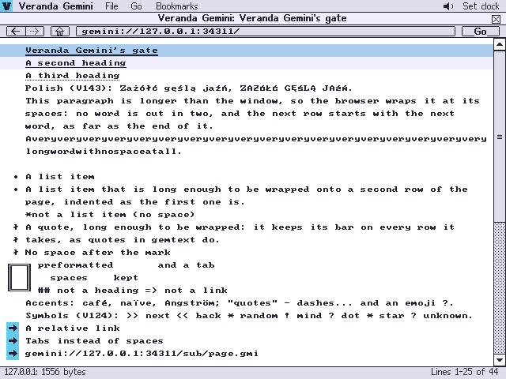
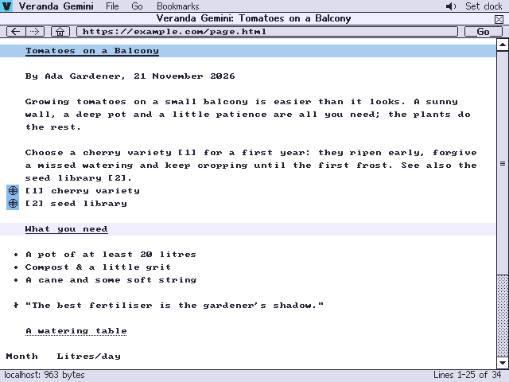
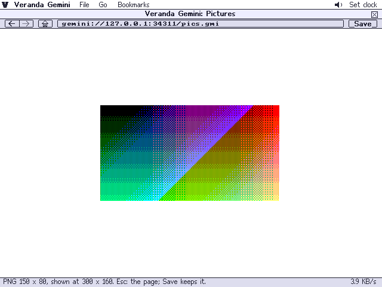
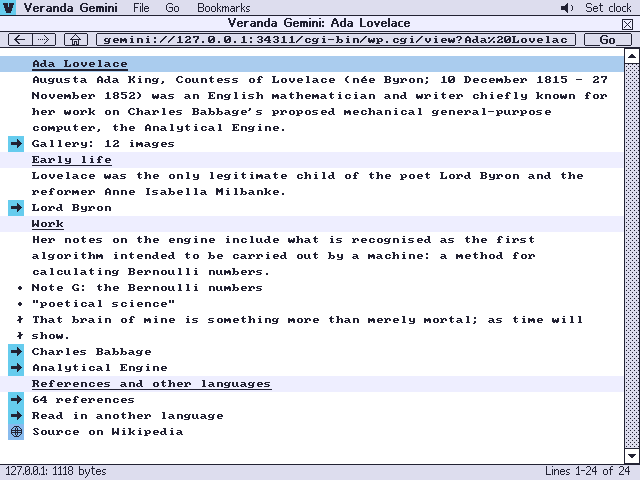

# Veranda Gemini

Veranda Gemini is a browser for **Gemini**, a small protocol for small,
text-based pages ("capsules"). It can also show **web pages** turned
into text, **PNG pictures**, and **Wikipedia**. It works through the
Wi-Fi modem and needs Zimodem with `ATCS` (see
[Network setup](Network-setup.md)).

## Start it

- Double-click **Veranda Gemini** in `/VERANDA/APPS`. It starts on the
  bookmarks page.
- Double-click **Wikipedia** in `/VERANDA/APPS` (a W on a globe): Veranda
  Gemini starts and asks "Look up in Wikipedia:".

## Browse

- **The address line**: type an address such as
  `gemini://geminiprotocol.net/docs/`, or just a host name. Press Return
  or click **Go**. Click the line, press Ctrl+L, or start typing. Ctrl+V
  pastes. Esc leaves the line.
- **Pages**: headings are underlined, list items have a bullet, quotes
  a bar. Preformatted text keeps its columns (a line wider than the
  window is cut). Paragraphs wrap to the window.
- **Links** have a badge: an arrow (cyan) for Gemini, a globe for the
  web, a folder (yellow) for Gopher, an envelope (purple) for mail, a
  picture (orange) for an image, grey for anything else.
- **Click a link** to follow it (Shift+click only selects it). Or press
  **Tab** (Shift+Tab back) to move from link to link and **Return** to
  follow.
- **Questions**: a capsule may ask for text (a search). A box asks you.
  Do not type secrets: the box shows what you type, and see Security
  below.
- **Redirects** are followed (5 at most). A redirect to another host
  asks first.
- **Plain text** pages are shown wrapped. **Other files** ask whether to
  download them to `/DOCUMENTS`. **File > Download** downloads the
  selected link (or the page) without asking. **Stop** (or Esc) stops.
- **Back** and **Forward** (the toolbar, the Go menu, Left and Right,
  Backspace): the last 14 pages. The last three come back at once from
  memory. **Reload**: Ctrl+R. **Home**: the bookmarks page.
- **Find** (File > Find..., Ctrl+F) finds a word in the page; **Find
  again** (Ctrl+G) the next one. A word wrapped across two rows is not
  found.
- **Scrolling**: the wheel, Up, Down, PgUp, PgDn, Home, End, or the
  scroll bar at the right: its arrows move a row (hold one down to keep
  going), a click on the track above or below the thumb moves a page,
  and the thumb can be dragged.
- The menus show each command's key at the right. The box at the right
  of the title bar quits, as **Veranda Gemini > Quit** (Ctrl+Q) does.

A Gopher or mail link only shows where it leads ([Veranda
Gopher](Veranda-Gopher.md) opens Gopher addresses).

## Bookmarks

**Bookmarks > Add this page** adds the page (named by its first
heading). **Remove...** removes the bookmark selected (with Tab) on the
bookmarks page. Up to 16.

Without your own bookmarks file, Veranda Gemini starts with: Project
Gemini, the Kennedy search engine, geminispace.info's search, the Antenna
feed, gemi.dev, NewsWaffle, Gemipedia and Gemipedia's featured articles.
(The first four were written from memory and not checked.)

Your bookmarks are in `/VERANDA/.SYSTEM/GEMINI.MARKS`, one link per
line:

    => gemini://geminiprotocol.net/ Project Gemini

The package never replaces this file. If you have one from before, add
these lines by hand to get the new services:

    => gemini://gemi.dev/ gemi.dev
    => gemini://gemi.dev/cgi-bin/waffle.cgi NewsWaffle: web pages as gemtext
    => gemini://gemi.dev/cgi-bin/wp.cgi/ Gemipedia: Wikipedia
    => gemini://gemi.dev/cgi-bin/wp.cgi/featured Wikipedia: featured articles

## Web pages

The X16 has no web browser, but Veranda Gemini can show ordinary web
pages as text: their text, headings, lists and links. Follow an
`http://` or `https://` link, or type such an address. A box asks:

- **Yes**: through **NewsWaffle**, a free public service at gemi.dev. It
  fetches the page and sends it back as gemtext. It is best for articles
  and news. **It sees every page you read through it**, and it may be
  slow, change or go away.
- **No**: through **your own proxy** on a PC (below).
- **Cancel**: neither.

### Your own proxy: web_proxy.py

1. Copy `PC/web_proxy.py` from the card to a PC on your network (Python
   3, nothing to install).
2. Run `python3 web_proxy.py`. The first time it makes a certificate
   with `openssl` (or says how). It listens on port 1965 and takes
   requests only from home-network addresses.
3. In Veranda Gemini: **File > Settings...**, answer **2** (always my
   proxy) or **0** (ask), then type the PC's address, for example
   `192.168.1.20` (port 1965 if you give none).

The proxy keeps a page's article text, headings, lists and links (the
links numbered after each paragraph), and cuts a page at 64 KB. Its own
pages: `gemini://<the PC>/` (a start page), `/search` (a search through
DuckDuckGo), `/go` (asks for an address). Other Gemini proxies with TLS,
such as Duckling proxy or levior, work too.

### File > Settings...

Four boxes, one after another (leave one empty to keep it):

1. Web pages: **0** ask each time (the default), **1** always
   NewsWaffle, **2** always my proxy, **3** never.
2. Your proxy's `host:port`.
3. The largest picture shown without asking, in KB (256 at first).
4. Wikipedia's language: `en` (the default), `pl`, `de`, `fr`,
   `simple` ...

They are kept in `/VERANDA/.SYSTEM/GEMINI.CFG`.

## Pictures

A link to a picture has **[Show image]** after it. Click it (or Tab to
it and press Return, then **Yes** to show, **No** to save). A **PNG**
or **JPEG** picture is shown in the window in 16 colours, scaled to
fit. **Save** (or S) copies the picture to `/DOCUMENTS`. Anything
else goes back to the page: **Esc**, Backspace, Back, a click on the
picture or the wheel. Another key, a toolbar button or a menu goes back
to the page and then does its job, and the close box, **Quit** or
Ctrl+Q quit straight away. While a picture is still being drawn its
menus are off.

- Pictures with a palette of 16 colours or fewer keep their colours.
  Grey pictures get 16 greys. Photographs look posterised.
- A large picture takes time: a 740 x 300 PNG about 30 seconds, a
  Wikipedia photograph (a JPEG of about 440 x 290) about 11 seconds on
  an X16 whose VERA has FX (firmware 0.3.1 or later), about 19 seconds
  on an older one.
- Not shown (save them instead): progressive JPEG, GIF, BMP, interlaced
  PNG, very wide pictures. With Pillow on the PC (`pip install pillow`),
  `web_proxy.py` turns them into PNG for you.

## Wikipedia

Veranda Gemini reads Wikipedia through **Gemipedia**, a free public
Gemini front end to Wikipedia at gemi.dev.

- **Go > Wikipedia...** (Ctrl+W) asks "Look up in Wikipedia:". Type a
  title (it need not be exact) and press Return. Without an article of
  that name, you get Gemipedia's search.
- In the address line, `wp Ada Lovelace` (or `w Ada Lovelace`) looks it
  up. `wp` alone asks.
- The language is set in File > Settings... (the fourth box).

Gemipedia sees what you look up. It may be slow, change or go away.

## Security

Gemini always uses TLS. The modem makes the connection (`ATCS`) and
**does not check the capsule's certificate**, and Gemini's usual "trust
on first use" is not possible either. Someone on your network could
pose as a capsule. Do not type anything secret into a capsule's
questions. Client certificates are not supported.

## Limits

- A page keeps 32 KB. A longer one is cut ("Cut here"); File > Download
  saves all of it.
- An address is 255 characters at most. No IPv6 addresses, no
  international names.
- Text is shown in the X16's character set: accented letters it has,
  common emoji and symbols as short ASCII (`>>`, `*`), others as `?`.

**Alt+Tab** puts Veranda Gemini aside, even during a download.
