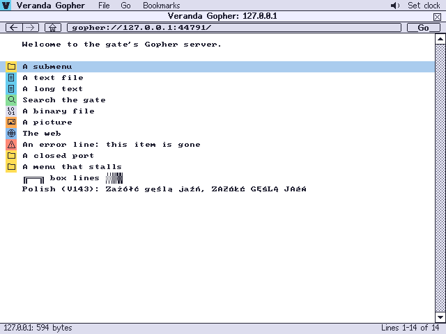
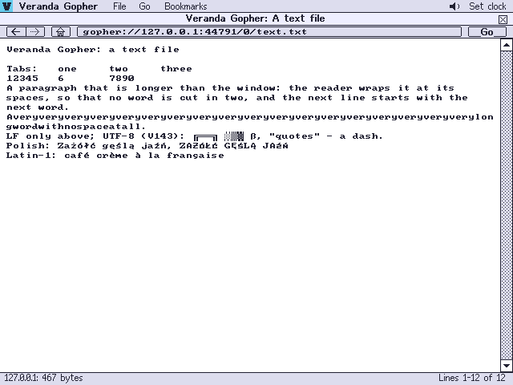

# Veranda Gopher

Veranda Gopher reads **Gopher**: the Internet of menus and plain text
from before the web. A server sends a menu; each item is another menu,
a text, a search or a file. It works through the Wi-Fi modem (see
[Network setup](Network-setup.md)).

## Start it

Double-click **Veranda Gopher** in `/VERANDA/APPS`. It starts on the
bookmarks page.

## Use it

- **The address line** at the top: type an address such as
  `gopher://gopher.floodgap.com/1/world`, or just a host name, and
  press Return or click **Go**. Click the line, press Tab or Ctrl+L, or
  just start typing. Ctrl+V pastes. Esc leaves the line.
- **Menus** show a badge before each item: a folder (yellow) for a menu,
  a page (blue) for a text, a magnifier (green) for a search, `10 01` for
  a binary file, a picture (orange), a note (purple) for a sound, a
  globe for a web link, a screen for telnet, a red warning sign for an
  error. Lines without a badge are information.
- **Click an item** to follow it (Shift+click only selects it). Or
  select it with Up and Down and press Return.
- **A search** asks for words in a box.
- **A file** asks whether to download it to `/DOCUMENTS`. **File >
  Download** downloads the selected item (or the text shown) without
  asking. **Stop** (the toolbar, File > Stop, or Esc) stops it. A file
  that did not come whole is deleted.
- **A web link** shows its address in a box. A telnet item shows its
  host and port: [Term](Term.md) can open it.
- **Back** and **Forward** (the toolbar's arrows, the Go menu, Left and
  Right, Backspace) move through the last 16 pages. **Reload** (Ctrl+R)
  fetches the page again. **Home** (the house) is the bookmarks page.
- **Scrolling**: the wheel, PgUp, PgDn, Home, End, or the scroll bar at
  the right: its arrows move a line (hold one down to keep going), a
  click on the track above or below the thumb moves a page, and the
  thumb can be dragged. Up and Down move from item to item in a menu, a
  line at a time in a text.
- The menus show each command's key at the right. The box at the right
  of the title bar quits, as **Veranda Gopher > Quit** does.

## Bookmarks

**Bookmarks > Add this page** adds the page shown. **Remove...**
removes the bookmark selected on the bookmarks page. Up to 16.

Without bookmarks of your own, the page has a few well-known servers
(Floodgap, its Veronica-2 search, Quux.org, SDF, Bitreich). Your
bookmarks are kept in `/VERANDA/.SYSTEM/GOPHER.MARKS`, a Gopher menu
(one line per item: the kind and name, a TAB, the selector, a TAB, the
host, a TAB, the port). You can write it on a PC.

## Limits

- A page keeps 48 KB and 4,000 lines. A longer one is cut, and says so.
  (File > Download saves all of it.)
- Text is shown in the X16's character set: UTF-8 letters show as odd
  characters.
- Lines are 76 columns (a menu item's name 73).
- No Gopher+, no TLS, no web pages.
- One thing at a time: a page or a download.

**Alt+Tab** puts Veranda Gopher aside, even during a download.
