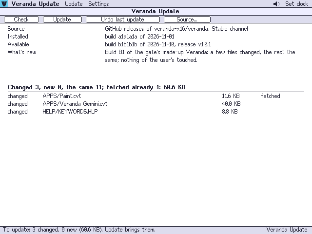
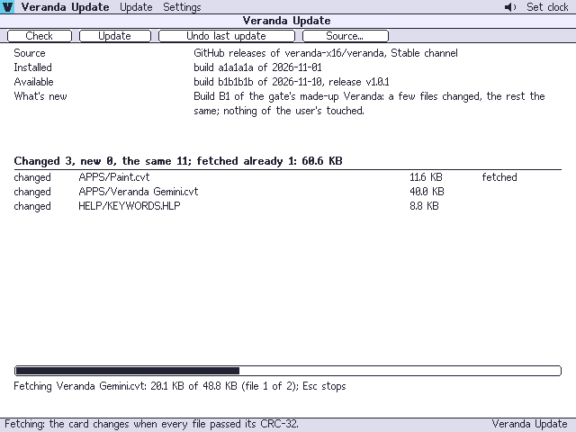

# Veranda Update

Veranda Update brings Veranda on your SD card **up to date over the
network**: from the GitHub releases of Veranda's public repository, or
from your own package on a PC on your home network. It uses the Wi-Fi
modem (see [Network setup](Network-setup.md)).

## Use it

1. **Check** (C): Veranda Update fetches the list of files of the newest
   build (`UPDATE.LST`) and compares your card with it, file by file
   (size and CRC-32). It shows the build you have, the one available,
   "what's new", and every changed and new file with its size. "Up to
   date" when there is nothing to fetch.
2. **Update** (U): it fetches the files to `/VERANDA/.SYSTEM/UPD/` and
   checks each one. **Only when all have come and passed** are the
   card's files replaced. Veranda's system files go last.
3. When a system file changed: **Restart to finish**. Veranda quits to
   BASIC, which starts Veranda again.

**Ctrl+Q** quits, as Quit does (a job running stops first).

### If something goes wrong

- A dropped connection, **Esc**, or a file that fails its check stops
  the update, and **the card is as it was**. **Update** again goes on
  where it stopped: the files that came whole are kept.
- **Alt+Tab** puts it aside at any time; the file being fetched starts
  again when you come back.
- If the power goes off while files are replaced, Veranda Update
  finishes the job at its next start.

### Undo

**Undo last update** puts back what the last update replaced, and
removes what it added. The replaced files are kept in
`/VERANDA/.SYSTEM/OLD/<build>/`. One undo is kept: the backup of the
update before is deleted when a new one is made.

## Dictionaries for Write

**Dictionaries** (D, also in the Update menu) checks the list of
[Veranda Write](Veranda-Write.md)'s spelling dictionaries instead of
Veranda's: they are not part of Veranda's updates. They come from their
own release, **dict-1** of `veranda-x16/veranda-write` on GitHub,
whatever Source... says. The window lists the dictionaries that are new
or changed; **Update** then asks for each one (English, Polish), checks
that the card has room, fetches the ones you chose, checks each file and
puts them in `/VERANDA/DICT`. **Undo last update** removes them again.
Veranda's own files and its build do not change.

Veranda Write's **Tools > Get dictionaries** opens Veranda Update this
way by itself; when you **Quit**, Veranda Write comes back.

## What it never touches

- `/DOCUMENTS` (your files).
- Your settings in `/VERANDA/.SYSTEM`: settings files, chats, bookmarks,
  notes, preferences.
- Any file the list does not name. A file that is no longer in the list
  is **not** deleted.

## Source...

Choose where updates come from:

- **GitHub releases**: `owner/repo`, `veranda-x16/veranda` at first (a
  card that saved the old `sandlbn/veranda-x16` reads the new one). The
  modem makes the TLS connection (`ATCS`) and **does not check the
  certificate**. Each file's CRC-32 catches a cut or damaged file, but
  not a forged one. Only Veranda and its author's own MIT programs are
  published there.
- **A PC on my network**: copy `PC/update_server.py` to a PC that has a
  Veranda package (a folder like the one you installed), and run:

      python3 update_server.py /path/to/the/package

  Then type the PC's address with port 8644, for example
  `192.168.1.20:8644`. Plain HTTP on your home network; only home
  addresses may connect. It serves the **whole** package, so never open
  its port to the Internet.

The choice is kept in `/VERANDA/.SYSTEM/UPDATE.CFG`. [About this
X16](About-this-X16.md) shows the build installed.
