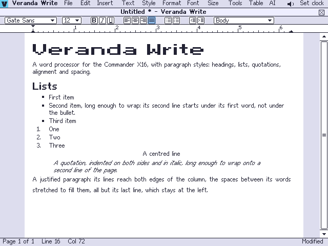
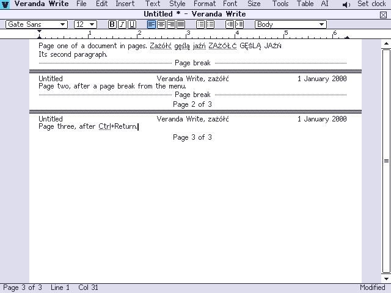
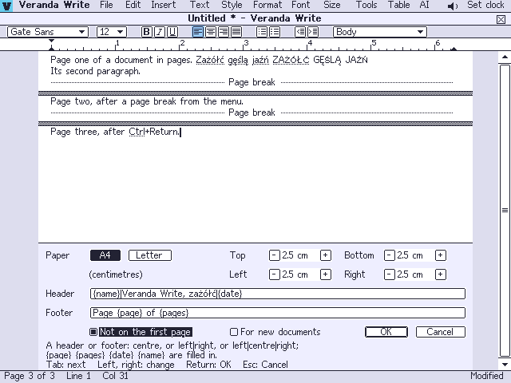
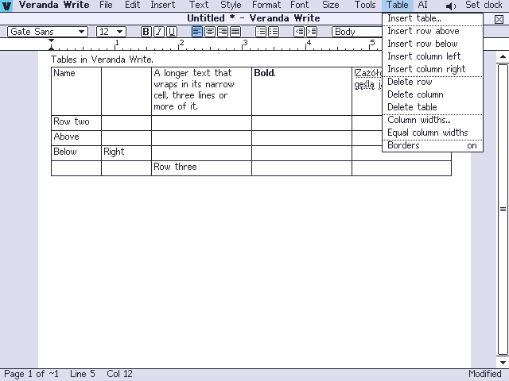
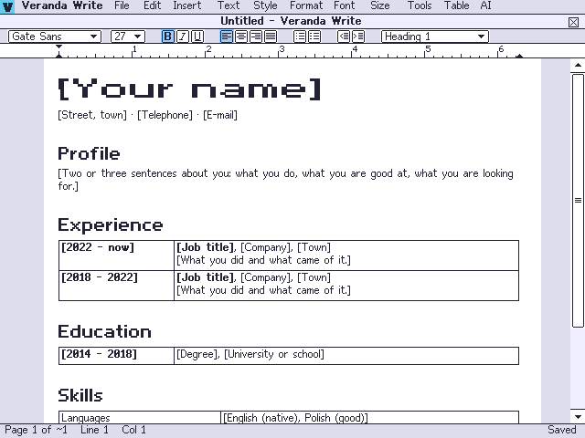
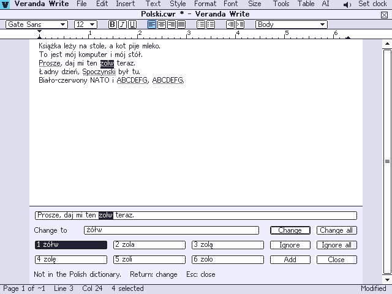
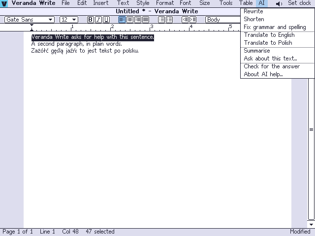
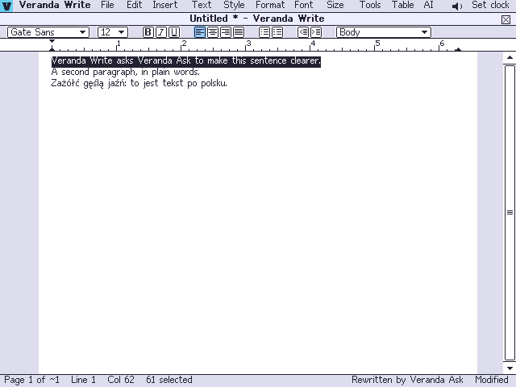

# Veranda Write

Veranda Write is **Veranda's word processor**. Use it for letters,
stories, reports, a CV and any text with fonts, styles, pages and
tables. It opens and exports Word (`.docx`) and OpenDocument (`.odt`)
files, and exports PDF for printing. For plain text files (programs,
lists, configuration files) use [Veranda Edit](Veranda-Edit.md).

Veranda Write runs only on Veranda. This page describes version 0.5.
MIT licence, Copyright (c) 2026 Marcin Spoczynski.

Veranda Write was called **Commander Write** before Veranda 1.0. Its
documents (`.cwr`) are the same: those you made before open as they did.
If `/VERANDA/APPS` still has `Commander Write`, you can delete it.

## Start it

- Double-click **Veranda Write** in `/VERANDA/APPS` (the **Apps**
  place in the sidebar).
- Or double-click a `.cwr` document: Veranda Write opens it.

Without a document it starts with an empty page, and its Open and Save
box starts in `/DOCUMENTS`.

New to it? Try [Your first letter](Your-first-letter.md) first.

## The window

- **The menu bar**: Veranda Write, File, Edit, Insert, Text, Style,
  Format, Font, Size, Tools, Table, AI. Each item shows its keys at the
  right.
- **The title band**: the document's name, `*` when there are unsaved
  changes, and a close box.
- **The toolbar**: lists for the font, the size and the paragraph's
  style; **B**, **I**, **U**; four alignment buttons; a bulleted and a
  numbered list; indent less and indent more.
- **The ruler**: inches, and the paragraph's indents.
- **The page**: the text wrapped to the paper's width less the margins.
  Where a page ends you see its footer, a grey band and the next page's
  header.
- **The status bar**: "Page 3 of 12", line, column, and "Modified".

## Features

### Character styles

- Any font in `/VERANDA/FONTS` at its sizes (Gate Sans 9, 12, 18, 27;
  Gate Mono 10 and 12; the system font).
- **Bold**, *italic* and underline, mixed freely on a line.
- **Text > Larger** (Ctrl+E) and **Smaller** (Ctrl+Shift+E) step
  through the font's sizes.
- With text selected, a style changes the selection. With nothing
  selected, it changes what you type next.
- Polish letters (typed with right Alt and Veranda's Polish keyboard),
  and German, French, Hungarian, Romanian and Croatian ones.

### Paragraph styles

The **Style** menu (and the toolbar's style list) has named styles:

| Style | Looks like |
|---|---|
| Body | normal text |
| Heading 1, 2, 3 | bold, 27, 18 and 12 points |
| Quote | indented on both sides, italic |
| Bulleted list | a bullet before each paragraph |
| Numbered list | 1, 2, 3 ... before each paragraph, counted by itself |

- Return after a heading gives Body.
- Return in an **empty** list item ends the list.
- Clicking an active list button in the toolbar goes back to Body.

The **Format** menu sets: align left, centre, align right, justify;
indent more and less (a quarter inch each); single, one and a half, or
double line spacing; space after paragraphs (on or off). These apply to
the selected paragraphs, or to the cursor's paragraph.

### Pages, headers and footers

The text fills pages of the paper you choose. A line that does not fit
starts the next page. The status bar, **Word count** and **Go to page**
count the same pages.

- **Insert > Page break** (Ctrl+Return) starts a new page where you
  want. It shows as a dotted line labelled "Page break"; delete it like
  a character.
- **File > Page setup...** chooses the paper, **A4** or **US Letter**,
  and the four margins (in centimetres on A4, in inches on Letter). Each
  document keeps its own. **For new documents** makes it the default
  for new documents too (A4 with 2.5 cm margins until you change it).
- **Insert > Header and footer...** opens the same panel. The header
  and the footer are one line each, printed in the top and bottom
  margins:
  - `centre`, `left|right` or `left|centre|right` (the `|` splits the
    line into parts);
  - `{page}` the page's number, `{pages}` the number of pages, `{date}`
    today's date, `{name}` the document's name; for example
    `{name}||Page {page} of {pages}`;
  - **Not on the first page** leaves them off page one (for a letter or
    a title page).

In the panel: **Tab** and the up and down arrows move between its
items; left and right (or Space) change the paper, a margin (a
millimetre or a twentieth of an inch a step) or an option; typing edits
the header or the footer; **Return** is OK, **Esc** Cancel. The mouse
clicks the buttons, the margins' **-** and **+**, the fields and the
options.

### Export as PDF and printing

**File > Export as PDF...** (Ctrl+Shift+P) writes a PDF of the
document, by default in `/DOCUMENTS` with the document's name. It has
the pages as you see them, at the paper's size and margins, with the
header and footer, the styles, lists, page breaks and tables. The text
is real text in the PDF (Helvetica, and Courier for Gate Mono): you can
select and search it, Polish letters too. The status bar shows the page
being written; **Esc** stops it.

The X16 has no standard printer, so Veranda Write **prints through
PDF**: export the document, copy the PDF to a PC (or open the card
there) and print it from any PDF viewer.

### Word and OpenDocument files

**Opening:** File > Open lists `.docx` (Word) and `.odt`
(OpenDocument, LibreOffice) files with your documents. Open one and
Veranda Write converts it; the original file is never changed.

- It opens as *Untitled-name*; the status bar says "Converted from
  Word" (or OpenDocument) and a box lists what was left out.
- **Kept:** the text, paragraphs with their alignment, indents and
  spacing, Heading 1-3, quotations, lists, bold, italic, underline,
  sizes (made the nearest of Veranda Write's), tabs, line and page
  breaks, the paper and margins, one line of header and footer with
  page numbers, and tables.
- **Left out:** pictures, drawings, formulas, text boxes, footnotes,
  comments, colours; tracked changes are taken as accepted.
- **Save as** offers `name.cwr`: save it as a Veranda Write document to
  keep working on it.

**Exporting:** **File > Export as Word (.docx)...** and **Export as
OpenDocument (.odt)...** write a copy of the document, by default in
`/DOCUMENTS` with the document's name. Word and LibreOffice open it with
its styles, headings, lists, fonts (Arial, and Courier New for Gate
Mono), sizes, page breaks, tables, the page setup and the header and
footer. Your document itself stays a `.cwr`. **Esc** stops an export.

### Tables

**Insert > Table...** asks for the columns and the rows ("3 x 3"; 8
columns at most) and puts the table at the cursor.

- Each cell holds text in any styles, and paragraphs of its own: Return
  in a cell starts a new paragraph in that cell. A cell's paragraph can
  have its own alignment or be a list.
- The text wraps inside its cell; a row is as tall as its tallest cell.
- **Tab** goes to the next cell (in the last cell it adds a row),
  **Shift+Tab** to the one before. The arrows, Home and End move by the
  cell's lines.
- The **Table** menu: Insert table..., Insert row above, Insert row
  below, Insert column left, Insert column right, Delete row, Delete
  column, Delete table, Column widths..., Equal column widths, Borders
  (on or off).
- **Column widths...** takes per cent values, for example `25 50 25`;
  columns you leave out share what is left.
- Every table change is one undo step. Spelling works in cells.

Good to know: Backspace at the start of a cell and Delete at its end do
nothing (they would join two cells). A selection that covers parts of
two cells cannot be typed over or deleted; select inside one cell, or
the whole table. Backspace just after a table goes into its last cell.

### Templates

**File > New from template...** lists ready-made documents:

- **English:** Letter, CV, Report (with a table, and page numbers in
  the footer), Meeting notes.
- **Polish:** List, Curriculum vitae, Raport, Notatka ze spotkania.
  These are listed instead when the language for new documents in
  **Tools > Spelling options** is Polish (or "Keyboard's" with
  Veranda's Polish keyboard on).
- **Blank document** first, and your own templates after Veranda's,
  marked "(yours)".

Choose one with the arrows and **Return** (or a click); **Esc** closes
the list. The template opens as a new Untitled document, with today's
date filled in where it says `{date}` ("25 November 2026", or "25
listopada 2026" in a Polish one). Replace the text in brackets with
your own. Saving asks for a name: the template itself never changes.

**File > Save as template...** keeps the document as one of your
templates, in `/DOCUMENTS/Templates`. Veranda's updates never touch that
folder. To delete or rename one of yours, use the desktop. Veranda's own
templates are in `/VERANDA/TEMPLATES` (`EN` and `PL`); an update may
replace them.

### Find and Replace

**Edit > Find...** (Ctrl+F) or **Replace...** (Ctrl+H) opens a panel
under the text: **Find**, **Replace with**, **Match case**, **Whole
word**, **Find next**, **Replace**, **Replace all**. A match may span a
style change. **Replace all** is one undo step. The text to find is 40
characters at most.

### Spelling

Veranda Write checks spelling in **English** and **Polish**.

- As you type, words the dictionary does not have get a **dotted
  line** (looked at when you pause, so typing is not slowed down).
- **Tools > Check spelling...** (F7) goes through the document from the
  cursor in a panel under the text: the word in its sentence, up to six
  suggestions, and **Change**, **Change all**, **Ignore**, **Ignore
  all**, **Add** (to your own words) and **Close**.
- **F8**, or a **right click** on a marked word, shows its suggestions
  in a small list: click one or press its number; Esc closes it.
- **Tools > English** or **Polish** sets the document's language; the
  document keeps it.
- **Tools > Mark misspellings** turns the dotted lines off and on.
- Your own words are kept in `/VERANDA/.SYSTEM/WRITE.UDIC`.

**Tools > Spelling options...** keeps three settings between runs (in
`/VERANDA/.SYSTEM/WRITE.CFG`):

- **Check spelling as you work**: off, spelling is loaded only when you
  ask (F7, F8 or the Tools menu), and nothing is marked before that.
- **Mark misspellings as you type**.
- **New documents**: the language of new documents and of documents
  saved without one: **English** (the default), **Polish**, or
  **Keyboard's** (Polish when Veranda's Polish keyboard is on).

In the options: Tab and the up and down arrows move, Space and left and
right change, Return is OK, Esc Cancel.

**The dictionaries are a separate download** (1.9 MB: English 0.7 MB,
Polish 1.1 MB); they are not in Veranda's package. To get them:

- **Tools > Get dictionaries...**: Veranda Write goes aside and
  [Veranda Update](Veranda-Update.md) starts and checks the
  dictionaries' list. Choose English, Polish or both; Update fetches them
  over the Wi-Fi modem into `/VERANDA/DICT`. Its **Quit** brings Veranda
  Write back, and the next Check spelling uses them.
- Or **by hand**: download `Veranda-Write-dictionaries.zip` from the
  release **dict-1** at
  [github.com/veranda-x16/veranda-write/releases](https://github.com/veranda-x16/veranda-write/releases)
  and copy its `VERANDA` folder to the card. Each dictionary has its
  licence beside it (`EN.DIC.txt`, `PL.DIC.txt`; see
  [Licences](Licences.md)).

Without a dictionary, Check spelling says how to get it; while you type
nothing asks and no words are marked. Dictionaries already on a card
from an earlier package keep working.

### AI help (optional)

Veranda Write can have [Veranda Ask](Veranda-Ask.md) work on a piece
of your text. It is optional: nothing happens unless you choose it, and
nothing leaves the X16 until you click **Send** in Veranda Ask.

The **AI** menu:

| Item | What you get |
|---|---|
| Rewrite | the text rewritten, in its place |
| Shorten | a shorter text, in its place |
| Fix grammar and spelling | the text corrected, in its place |
| Translate to English, Translate to Polish | the translation, in its place |
| Summarise | a summary, as new paragraphs after the paragraph |
| Ask about this text... | your question (60 characters at most) answered, after the paragraph |
| Check for the answer | takes an answer that came later (below) |
| About AI help... | a short note |

**How to use it:**

1. Select the text (up to 8,192 characters). With nothing selected,
   the paragraph at the cursor is used; Veranda Write selects it first
   so you see what goes.
2. Choose an item in the **AI** menu. Veranda Write goes aside and
   Veranda Ask opens with the request: the message exactly as it would
   be sent. The hint at the bottom says: "Press Return to send (then to
   use the answer). Esc: cancel."
3. **Send** (or Return) sends it. The answer appears as it comes.
4. Read it, then choose **Use this** (Return), **Try again** (a new
   answer) or **Cancel**. Veranda Write comes back.

With **Use this** the answer is put in and selected, and the status
bar says what was done ("Rewritten by Veranda Ask"). It is one undo
step: **Undo** (Ctrl+Z) brings your text back. With **Cancel** nothing
changes ("AI help cancelled"). In a table, AI help works on the text of
one cell.

**Before the first use:** start Veranda Ask and sign in with your
ChatGPT plan, or add an OpenAI API key, in Veranda Ask itself (see
[Veranda Ask](Veranda-Ask.md)). Veranda Write has no network code, no
key and no sign-in of its own.

**What is sent, and when:** only the selected text (or the paragraph):
its characters, no styles; your question, if you asked one; and the
task. Nothing else of the document, and only after you click **Send**.
The text goes to OpenAI, the service Veranda Ask uses, under its terms.
Do not use AI help on text you must not share. Requests are not kept in
Veranda Ask's chats, and the request files in `/VERANDA/.SYSTEM` are
deleted when it is done.

**When it does not work**, Veranda Write says why when it comes back:

- "Veranda Ask is not signed in. Open Veranda Ask and sign in (or add
  an API key in its Settings)."
- The network card could not be used: Veranda Ask's message, for
  example "Not enough memory for the network card". A program put aside
  holds the memory: quit one (Alt+Tab, then its Quit), or choose
  **Roomy** switching in [Preferences](Preferences.md), and ask again.
- "Veranda Ask did not start (too little memory?)": nothing was sent.
  Close a program, then ask again.
- "The text is too long for AI help": select less (8,192 characters at
  most).
- A selection over two cells of a table, or one with a whole table in
  it, is refused: select inside one cell.

**One request at a time.** If you go back to Veranda Write with Alt+Tab
before Veranda Ask has answered, Veranda Write says "Veranda Ask has not
answered yet". When it has, the answer is taken the next time Veranda
Write comes back, or with **AI > Check for the answer**. If you changed
the text meanwhile, the answer is not used: ask again. While that
Veranda Ask is still aside with its request, a new request is refused:
switch to it (Alt+Tab) and Send or Cancel there first.

**Turn it off:** **Tools > AI help (Veranda Ask)** turns the AI menu
off and on again. The setting is kept in `/VERANDA/.SYSTEM/WRITE.CFG`.

### Other tools

- **Veranda Write > Word count...**: words, characters, characters
  without spaces, paragraphs and pages, and the selection's words.
- **Edit > Go to page...** (Ctrl+Shift+G).
- **Insert > Date and time** (Ctrl+Shift+D), in the form
  "21 November 2026, 14:05", from the X16's clock.
- **Undo and redo**, many levels: typing, deleting, formatting,
  pasting, tables, AI help.
- **Cut, copy and paste.** Inside Veranda Write the styles are kept.
  With other programs the text goes through Veranda's clipboard, as
  plain text.
- **Alt+Tab** puts Veranda Write aside with its document.

## Menus

| Menu | Items |
|---|---|
| Veranda Write | About Veranda Write, Word count... |
| File | New (Ctrl+N), New from template..., Open... (Ctrl+O), Save (Ctrl+S), Save as... (Ctrl+Shift+S), Save as template..., Page setup..., Export as PDF... (Ctrl+Shift+P), Export as Word (.docx)..., Export as OpenDocument (.odt)..., Close (Ctrl+W), Quit (Ctrl+Q) |
| Edit | Undo (Ctrl+Z), Redo (Ctrl+Y), Cut (Ctrl+X), Copy (Ctrl+C), Paste (Ctrl+V), Select all (Ctrl+A), Find... (Ctrl+F), Find next (Ctrl+G), Replace... (Ctrl+H), Go to page... (Ctrl+Shift+G) |
| Insert | Page break (Ctrl+Return), Date and time (Ctrl+Shift+D), Header and footer..., Table... |
| Text | Plain (Ctrl+T), Bold (Ctrl+B), Italic (Ctrl+I), Underline (Ctrl+U), Larger (Ctrl+E), Smaller (Ctrl+Shift+E) |
| Style | Body, Heading 1, Heading 2, Heading 3, Quote, Bulleted list, Numbered list |
| Format | Align left (Ctrl+L), Centre (Ctrl+Shift+C), Align right (Ctrl+Shift+R), Justify (Ctrl+J), Indent more, Indent less, Single spacing, One and a half lines, Double spacing, Space after paragraphs |
| Font | the installed fonts (up to 8) |
| Size | the sizes of the current font |
| Tools | Check spelling... (F7), Spelling suggestions (F8), Mark misspellings (on/off), English, Polish (the one "in use"), Spelling options..., Get dictionaries..., AI help (Veranda Ask) (on/off) |
| Table | Insert table..., Insert row above, Insert row below, Insert column left, Insert column right, Delete row, Delete column, Delete table, Column widths..., Equal column widths, Borders (on/off) |
| AI | Rewrite, Shorten, Fix grammar and spelling, Translate to English, Translate to Polish, Summarise, Ask about this text..., Check for the answer, About AI help... |

## Keys

| Key | Action |
|---|---|
| Arrows | move; with **Shift**: select |
| Ctrl+Left, Ctrl+Right | a word left, right |
| Home, End | start, end of the line |
| PgUp, PgDn | a screen up, down |
| Ctrl+Home (or Ctrl+PgUp), Ctrl+End | start, end of the document |
| Backspace, Delete | delete left, right (or the selection) |
| Return | a new paragraph |
| Tab | a tab (tab stops every half inch); in a table: the next cell |
| Shift+Tab | in a table: the cell before |
| Esc | remove the selection |
| Ctrl+N, Ctrl+O, Ctrl+S | New, Open, Save |
| Ctrl+Shift+S | Save as |
| Ctrl+W, Ctrl+Q | Close, Quit |
| Ctrl+Z, Ctrl+Y | Undo, Redo |
| Ctrl+X, Ctrl+C, Ctrl+V, Ctrl+A | Cut, Copy, Paste, Select all |
| Ctrl+T, Ctrl+B, Ctrl+I, Ctrl+U | Plain, Bold, Italic, Underline |
| Ctrl+E, Ctrl+Shift+E | larger, smaller size |
| Ctrl+L, Ctrl+Shift+C, Ctrl+Shift+R, Ctrl+J | align left, centre, align right, justify |
| Ctrl+F | Find (the panel) |
| Ctrl+H (or Ctrl+R) | Replace (the panel) |
| Ctrl+G | Find next (also with the panel closed) |
| Ctrl+Shift+G | Go to page |
| Ctrl+Shift+D | Insert date and time |
| Ctrl+Return | Insert a page break |
| Ctrl+Shift+P | Export as PDF |
| F7 | Check spelling (in the panel: Ignore) |
| F8 | the spelling suggestions for the word at the cursor |
| Alt + any of these letters | the same as Ctrl |
| Alt+Tab | put Veranda Write aside |

**In the Find panel:** typing goes into the field; **Tab** switches
between Find and Replace with; **Return** finds the next; **Alt+C**
Match case; **Alt+W** Whole word; **Alt+N** Find next; **Alt+R**
Replace; **Alt+A** Replace all; **Esc** closes the panel. The arrows and
the Ctrl keys still work on the document.

**In the spelling panel:** typing edits "Change to"; Up and Down put the
suggestions in it; **Return** (or Alt+C) changes the word; **Alt+L**
Change all; **Alt+I** Ignore; **Alt+G** Ignore all; **Alt+A** Add;
**Alt+1** to **Alt+6** a suggestion; **Esc** closes it. A click on a
suggestion puts it in "Change to"; a double click changes the word.

**The mouse:** a click places the cursor; Shift+click and dragging
select (dragging past the top or bottom scrolls); a double-click selects
a word; a right click on a marked word shows its suggestions; the wheel
scrolls three lines; a click on the scroll bar goes a page up or down.

## Files

- Documents are `.cwr` files (Veranda Write's own format). **Save as**
  adds `.cwr` to a name without an extension. Names can be up to 63
  characters.
- **Word and OpenDocument files** (`.docx`, `.odt`) open, converted (see
  above), and the document can be exported as either.
- **geoWrite documents** open too, converted: the original is kept.
- **Plain text files** open too (File > Open, choose All files): LF,
  CR LF or CR line ends. The document is then untitled: Save asks for a
  name and saves a `.cwr` file. Veranda Write cannot save plain text.
- Saving is safe: Veranda Write writes a temporary file, then replaces
  the old file. If the write fails, the old file is still there.
- New, Close, Open and Quit ask "Save the changes to ...?" (Yes, No,
  Cancel). Save as asks before it replaces a file.
- Settings: `/VERANDA/.SYSTEM/WRITE.CFG` (spelling and AI help),
  `WRITE.UDIC` (your own words). Dictionaries: `/VERANDA/DICT`.
  Templates: `/VERANDA/TEMPLATES` and `/DOCUMENTS/Templates`.

## Limits

- **Document size:** up to 4 MB of text. A document larger than the
  X16's memory is kept partly on the card while you work, so the card
  needs free room for it. A big document shows its first page at once
  and is read on while you look at it.
- In one document: at most 128 character styles, 32 paragraph styles
  and 8 fonts.
- A font that is not in `/VERANDA/FONTS` is drawn in Gate Sans (the
  document keeps its name).
- **Pages:** A4 and US Letter. One header and one footer, a line of 63
  characters each. No footnotes, no different headers for odd and even
  pages.
- **Tables:** 8 columns at most; no table in a table and no merged
  cells (in a Word or OpenDocument file these become a cell's text and
  one wider cell). A row holds about 2,000 characters ("This row of the
  table is full") and is never split across pages. No page break inside
  a table.
- **Templates:** the list shows 11 at most; a template's name is 39
  characters at most in the list.
- **Word and OpenDocument:** what Veranda Write does not have is left
  out or made its own (fonts become Gate Sans or Gate Mono, sizes the
  nearest, tabs every half inch). Exported files are not compressed, so
  they are larger than Word's own. A `.docx` with about 100 KB of text
  opens in about half a minute.
- **Spelling:** a document is in one language. Words with digits, of
  one letter, or in capitals of up to five letters are not checked.
  Suggestions are not ordered by how common they are.
- **AI help:** 8,192 characters at a time; one request at a time; the
  answer is the model's: read it before you use it.
- **Undo** keeps about 24 KB of changes. The oldest steps go first. A
  single very large change (for example Replace all of more than about
  800 words) cannot be undone; Veranda Write says so. Save first.
- The clipboard for other programs holds the first 60,000 characters of
  a copy.
- Another program must not change a document's file while it is open
  in Veranda Write (parts of it are read again while you work).

## Tips

- Save often (Ctrl+S).
- Use Gate Sans for most text.
- Start a letter or a CV from **File > New from template...**.
- To print, **Export as PDF** and print the PDF on a PC.
- To send text to another program, select it, Ctrl+C, and paste it
  there.
