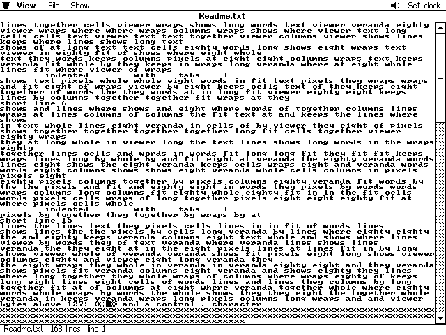
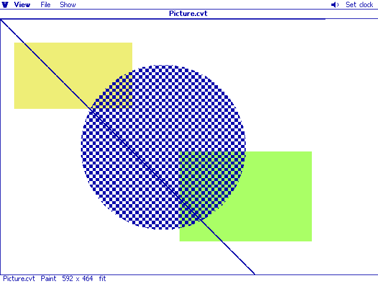
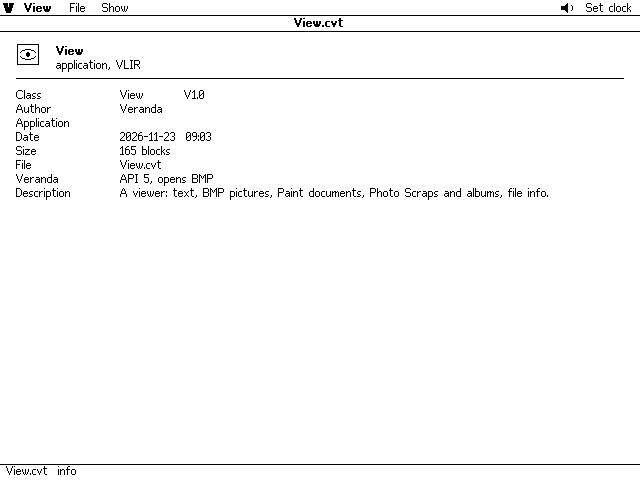

# View

View shows a file without the program that made it: text, pictures,
Paint pictures, clipboard scraps, and the information of any GEOS file.
Version 1.0. The desktop's **Help** item uses View to show this manual
on the X16.

## Start it

- Select a file in the desktop and choose **File > View**: any file.
- Double-click a `.BMP` file.
- Double-click **View** in `/VERANDA/APPS`: the Open box appears.

## What it shows

| Kind | How |
|---|---|
| Text | wrapped at 78 columns (words kept whole), tabs every 8 columns; any line ends; a scroll bar at the right |
| BMP pictures | uncompressed, 1, 4, 8 or 24 bits a pixel. 4-bit pictures keep their colours. |
| Paint pictures | with their colours |
| Photo Scraps and photo albums | a page at a time |
| Any other GEOS file | its info: icon, name, type, class, author, date, size, description |

A picture larger than the screen is shrunk to fit. A smaller one is
zoomed. **Show > Zoom: fit / 1:1** shows it at its real size; then the
arrows move it.

## Menus

| Menu | Items |
|---|---|
| View | About View, Quit |
| File | Open... (Esc), Open as text, Info, Copy |
| Show | Zoom: fit / 1:1, Find..., Find again, Next page (PgDn), Previous page (PgUp) |

- **File > Open as text** shows any file as text.
- **File > Copy** puts the picture, or the page of text shown, on
  Veranda's clipboard.
- **Show > Find...** finds a word in a text (case does not matter).
  **Find again** finds the next one.
- **Next page** and **Previous page** turn the pages of a photo album.

## Keys

| Key | In a text | In a picture |
|---|---|---|
| Up, Down | a line | move the picture (at 1:1) |
| Left, Right | | move the picture (at 1:1) |
| PgUp, PgDn (or Space) | a page | a screen; in an album, the page |
| Home, End | the start, the end | |
| Esc | the Open box (choose another file) | the Open box |

In a text, a click on the scroll bar's arrows moves a line, a click on
its track a page.

## Limits

- View keeps the file in RAM banks: up to about 290 KB of text with
  plenty of free memory, less when programs are put aside.
- It only shows; it does not change files.
